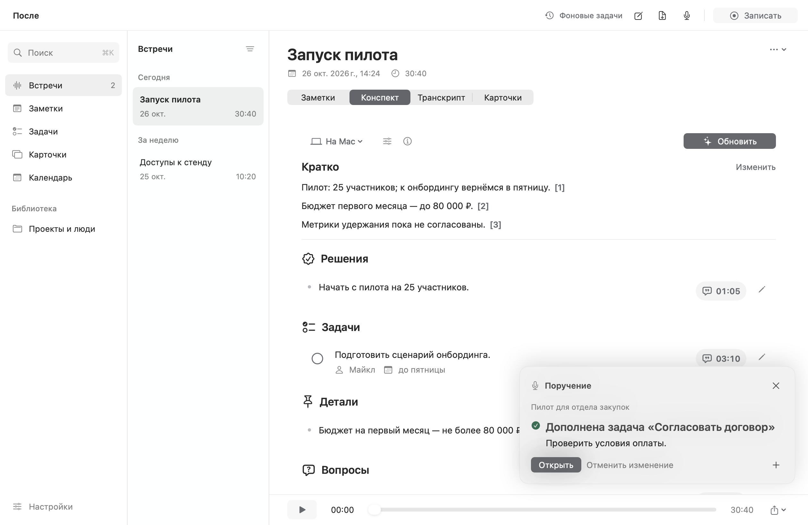
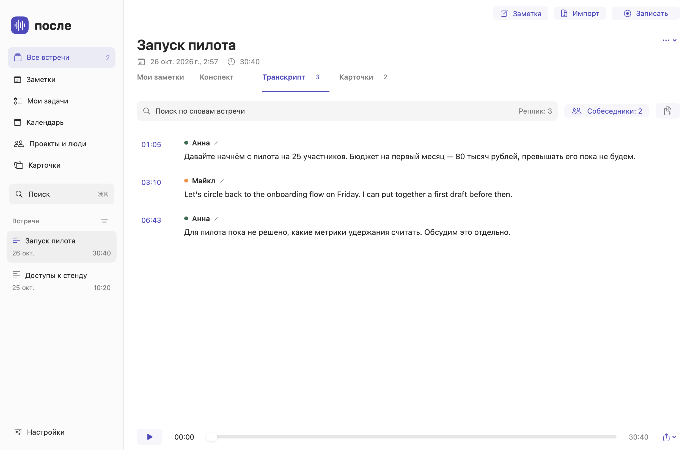

# После

После создано, чтобы после звонка не переслушивать всю запись: решения, задачи,
важные детали и полезные выражения остаются под рукой. Это нативное приложение
для Mac, которое объединяет встречи, личные заметки и повторение карточек.

**[Скачать приложение](https://github.com/starkovsavva/posle/releases)** ·
[Исходники](https://github.com/starkovsavva/posle) ·
[Компоненты и лицензии](THIRD_PARTY.md)

## Возможности

- **Запись встреч.** Микрофон и звук звонка, MP3 с качеством 64/128/192 кбит/с. По желанию — весь выбранный экран: до 720p, до 1080p или исходное разрешение, H.264 и 30 fps.
- **Транскрипция.** Русский и английский, разделение собеседников, имена и таймкоды. Parakeet и Whisper на Mac или совместимый облачный API. Копирование в Markdown одной кнопкой.
- **Конспект с источниками.** Решения, задачи, сроки и детали со ссылками на исходные реплики.
- **Заметки.** Форматирование, чеклисты, таблицы, папки, теги, вложения, OCR, закрепление и Корзина.
- **Поиск.** Встречи, транскрипты, конспекты, заметки и карточки в одном поиске — ⌘K.
- **Голосовые поручения.** Заметки, задачи и карточки по диктовке или текстовой команде — ⌃⌥M. Выбор из похожих объектов и отмена результата.
- **Задачи.** Сроки, ответственные, подзадачи и история дополнений. Задачи из конспектов сохраняют свою связь с источником.
- **Календарь.** День, 3 дня, неделя и месяц на всю рабочую область. Создание по свободному времени, блоки задач и события Google/Яндекса через календари macOS.
- **Карточки.** Повторение по FSRS внутри приложения, новые примеры, импорт CSV/TSV и экспорт в Anki.
- **Оформление.** Светлый и тёмный вид, цвет акцента, размер текста и плотность. Импорт и экспорт собственных тем.
- **Выбор моделей.** Локальный ИИ, Ollama, LM Studio, OpenAI, OpenRouter, Polza или свой совместимый сервер. Уже скачанные модели можно подключить повторно.

## Скриншоты

Примеры экранов на вымышленных данных. [Параметры записи](docs/screenshots/recording.png).


<p>
<a href="docs/screenshots/tasks.png"></a>
<a href="docs/screenshots/voice.png"></a>
</p>

<p>
<a href="docs/screenshots/transcript.png"></a>
<a href="docs/screenshots/notes.png"></a>
</p>
<p>
<a href="docs/screenshots/cards.png"></a>
<a href="docs/screenshots/calendar.png"></a>
</p>

## Установка

Нужны **Mac с Apple Silicon и macOS 15+**.

1. Скачайте **Posle-Mac-AppleSilicon.pkg** в [Releases](https://github.com/starkovsavva/posle/releases).
2. Запустите установщик. Он обновляет `/Applications/После.app`; удалять старую версию не нужно.
3. В **Настройках → Распознавание речи** выберите **На Mac → Скачать / проверить** или **Облако → Подготовить компоненты на Mac**. Веса скачиваются отдельно; можно подключить существующую модель.
4. В **Конспект и карточки** выберите локальный ИИ или облачный сервис. Для облака сохраните API-ключ и ID модели.

Следующие версии можно устанавливать в **Настройках → Обновления** с перезапуском приложения.

Доступен и ZIP с готовым приложением. Сборка пока без нотариализации Apple;
если macOS блокирует запуск, используйте [штатное разрешение запуска](https://support.apple.com/102445).

## Данные и модели

Записи и библиотека хранятся на Mac. Локальные модели работают офлайн после загрузки.
Облачная транскрипция отправляет аудио после подтверждения; облачный конспект получает
текст встречи. Облачный помощник получает поручение и содержимое выбранной встречи, заметки или задачи. API оплачивается у выбранного провайдера. Ключи хранятся в Связке ключей macOS.

Для своего сервиса нужен совместимый API: Chat Completions/Responses для текста или
`/audio/transcriptions` для аудио. Если сервис возвращает текст без таймкодов,
ссылки будут приблизительными, а точное разделение собеседников недоступно.

Google подключается через аккаунты macOS, Яндекс — через CalDAV в системном Календаре.
Библиотека, модели и ключи сохраняются при обновлении приложения.

## Разработка

SwiftUI/AppKit — интерфейс. Rust — библиотека, поиск, конспекты и карточки.
Parakeet, Whisper и разделение голосов работают через встроенный CPython в процессе
«После»; FFmpeg и локальные LLM выполняются отдельно.

```bash
bash scripts/setup-rust.sh
bash scripts/build.sh
open dist/После.app
```

Проверки: `scripts/check.sh`, `scripts/e2e.py` и `scripts/e2e_media.py`. Нативные сценарии запускаются в изолированной библиотеке с `--preview --check-voice`, `--check-tasks`, `--check-themes`, `--check-pipeline`, `--check-recording`, `--check-calendar` и `--check-calendar-workspace`.
Установщик и архив приложения собираются в `dist/`; записи, модели и локальная среда
в репозиторий не входят.
