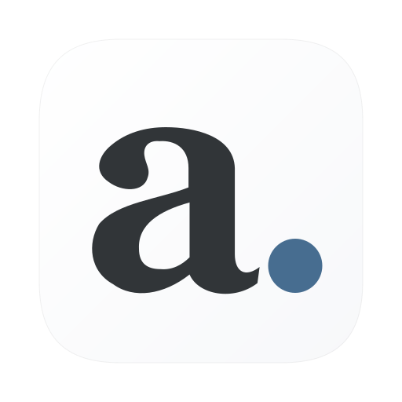

# После

Нативное приложение для Mac, чтобы не переслушивать встречи в поисках решений,
задач и важных деталей. Здесь же можно вести заметки, планировать дела и повторять
полезные фразы.

Интерфейс доступен на русском и английском (**After**). По умолчанию язык берётся
из macOS; изменить его можно в **Настройки → Общие → Язык интерфейса**.

**[Скачать для Mac](https://github.com/starkovsavva/posle/releases)** · Apple Silicon · macOS 15+

Запишите или импортируйте встречу → получите транскрипт и конспект →
сохраните важное в заметках.

**Начните с нужного.** Встречи, заметки, конспекты и транскрипты доступны сразу.
Карточки, задачи и проекты, календарь, помощник и смысловой поиск включаются
отдельно в **Настройках → Возможности**. Выбор сохраняется при обновлении.
Для каждой папки можно задать свои возможности, язык, стиль конспекта и модель.
Меню папки над разделами позволяет быстро менять контекст, а значок ползунков рядом
открывает её возможности. В **Все папки** он открывает общие значения по умолчанию.
Список **Папки** можно свернуть — выбор и доступ к настройкам остаются под рукой.

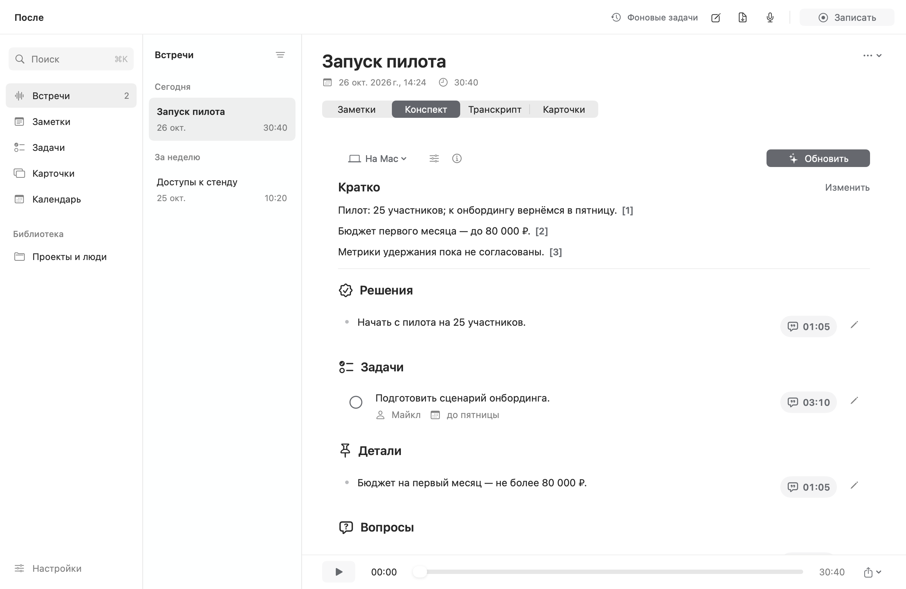

## Что умеет После

- **[Запись и распознавание](docs/screenshots/recording.png).** Микрофон и звук Mac в MP3 с выбором качества. По желанию — видео всего выбранного экрана, 30 кадров/с. Parakeet, Whisper или облачное распознавание; русский и английский, [разделение собеседников и правка реплик](docs/screenshots/transcript.png).
- **Конспекты и заметки.** Решения, задачи, сроки и детали со ссылками на исходные реплики. Транскрипт копируется в Markdown одной кнопкой. Контекст о вашей роли и цели встречи помогает выделять главное. Свои заметки поддерживают форматирование, чеклисты, папки, теги, вложения и распознавание текста на изображениях.
- **[Папки со своими настройками](docs/setup.md#папки-и-профили).** Например, «Английский» с карточками и английским конспектом, «Работа» — с задачами и другой моделью. Настройки наследуются от приложения или задаются для папки. Выбранная папка объединяет её встречи, заметки, задачи и колоды. [Перед записью](docs/screenshots/recording-folder.png) можно выбрать папку и настройку карточек для этой встречи.
- **[Задачи и контекст](docs/screenshots/contexts.png).** Список и доска, проекты, сроки и ответственные. К задаче можно прикрепить мысль, заметку, файл, фрагмент встречи или папку с кодом. В истории сохраняются изменения, отчёты и артефакты. Через MCP Codex, Claude и другие локальные агенты получают разрешённые материалы, берут задачу в работу и завершают её.
- **Карточки внутри приложения.** Создание включается для отдельной встречи или по умолчанию для папки. Повторение по интервалам, перевод и контекст из встречи. Кнопка генерации примера употребления, редактирование, колоды, импорт и экспорт.
- **[Поиск и помощник](docs/screenshots/assistant.png).** Поиск по словам и по смыслу, в том числе на другом языке. Помощник отвечает по библиотеке и календарю со ссылками на источники, продолжает вопросы и открывает найденные объекты. Голосом можно создавать и дополнять заметки и задачи, массово менять карточки с предпросмотром. Удалённые встречи, заметки, задачи и карточки доступны в Корзине 30 дней. Выбранные папки и репозитории индексируются с переходом к исходному файлу.
- **Календарь и трекеры.** День, три дня, неделя и месяц; календари Google и Яндекса через macOS. Отдельно подключаются Google Tasks и Яндекс Трекер: выбранные списки, получение и отправка изменений, сверка конфликтов. [Настройка доступа к трекерам](docs/tracker-sync.md).
- **[Локальные и облачные модели](docs/setup.md).** Модели внутри «После», Ollama, LM Studio, существующие файлы GGUF; загрузка или выбор совместимых уже установленных моделей. Для конспектов и помощника — [подписка ChatGPT](docs/chatgpt.md), OpenAI API, OpenRouter, Polza и совместимые сервисы. Фоновые задачи показывают ход обработки и позволяют повторить ошибку.
- **[Оформление и обновления](docs/screenshots/appearance.png).** Графит, матовое стекло и Liquid Glass на macOS 26; светлая и тёмная темы, цвет акцента, размер текста, плотность и импорт своих тем. Обновления устанавливаются из приложения с сохранением библиотеки и моделей. В **[Справка → Сообщить об ошибке…](docs/screenshots/bug-report.png)** можно подготовить и скопировать отчёт для разработчика.

## Как это выглядит

**Выбор возможностей:** оставьте базовые встречи и заметки или включите нужные инструменты.

<a href="docs/screenshots/features.png">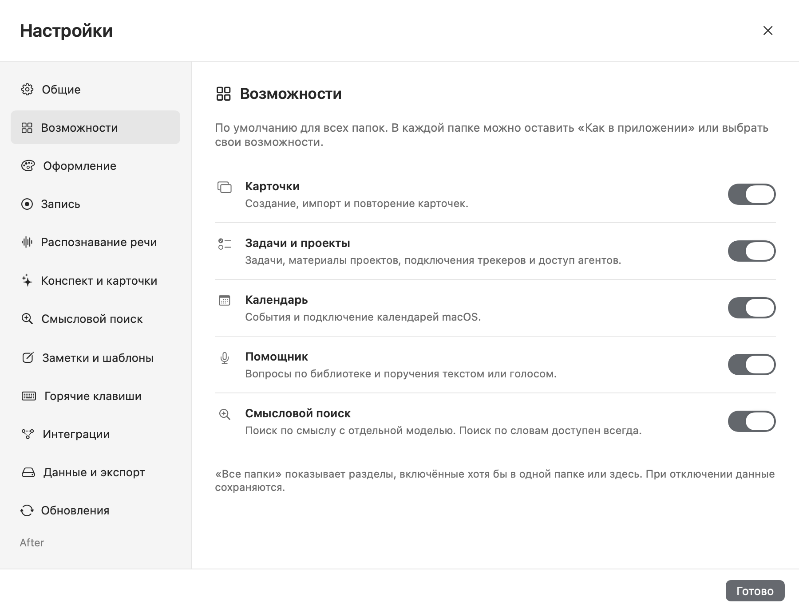</a>

**Папки в библиотеке:** создавайте папки, перемещайте встречи и переключайтесь между рабочими контекстами.

<a href="docs/screenshots/folders.png">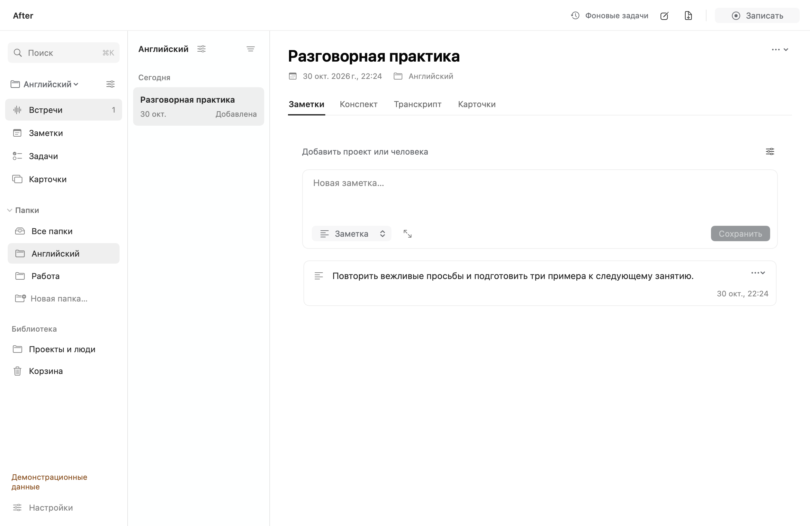</a>

**Разделы для каждой папки:** в английском можно оставить карточки без календаря, в работе — календарь без карточек. Для каждой возможности доступны общие настройки или свой выбор.

<a href="docs/screenshots/folder-features.png">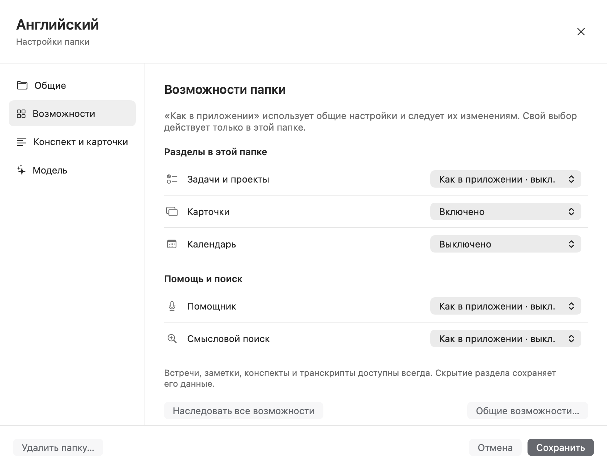</a>

**Настройки папки:** свой язык, стиль конспекта, генерация карточек и локальная или облачная модель.

<a href="docs/screenshots/folder-profile.png">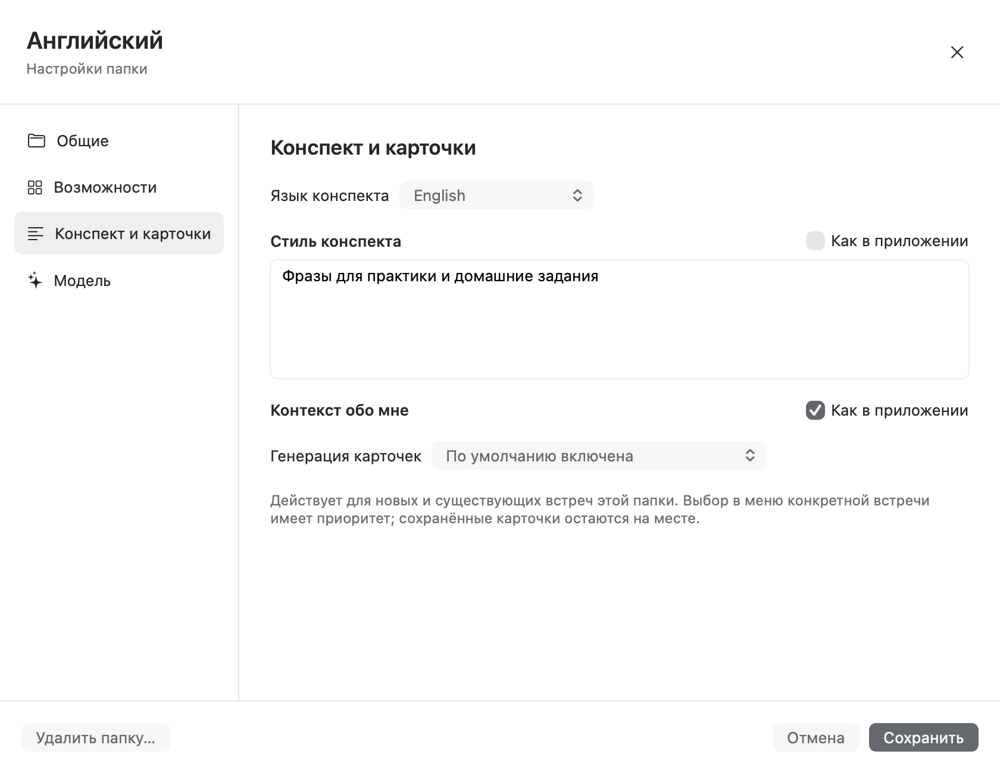</a>

**Язык интерфейса:** русский, English или язык системы. Названия и содержимое ваших материалов остаются без изменений.

<a href="docs/screenshots/interface-language.png">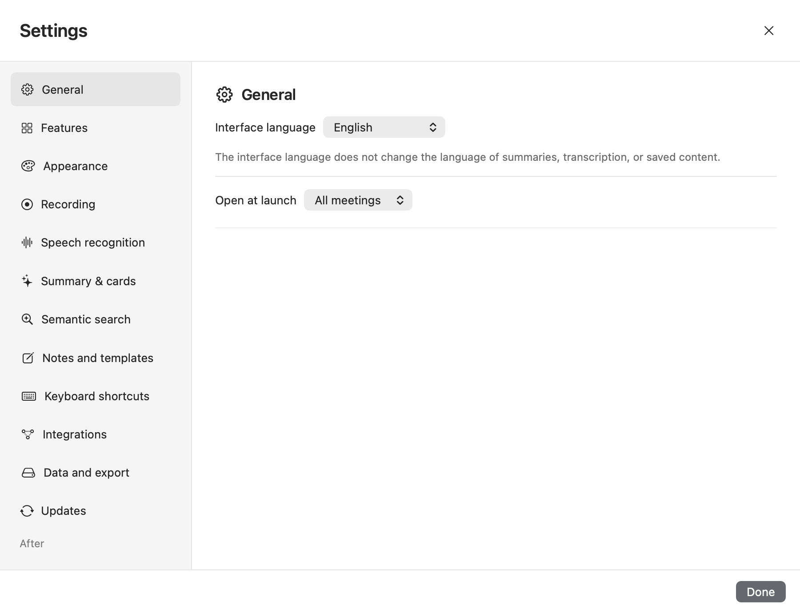</a>

**Заметки и задачи:** свои записи с папками и форматированием; задачи с материалами и историей.

<a href="docs/screenshots/notes.png">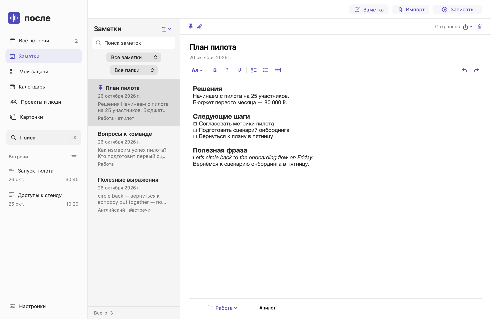</a>
<a href="docs/screenshots/tasks.png">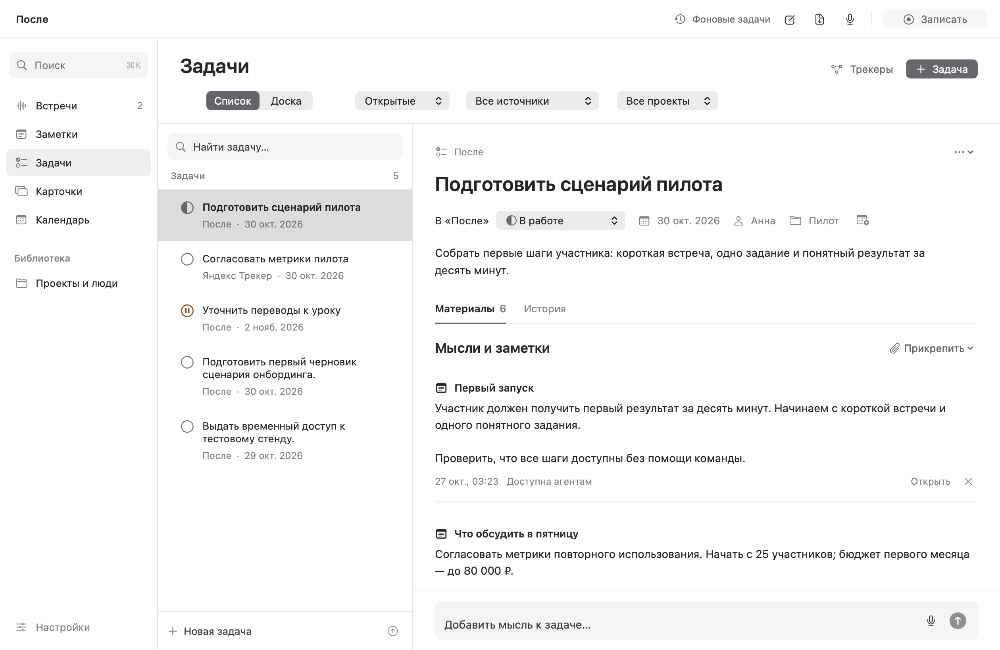</a>

**Карточки и календарь:** повторение с примерами; расписание встреч в выбранном виде.

<a href="docs/screenshots/cards.png">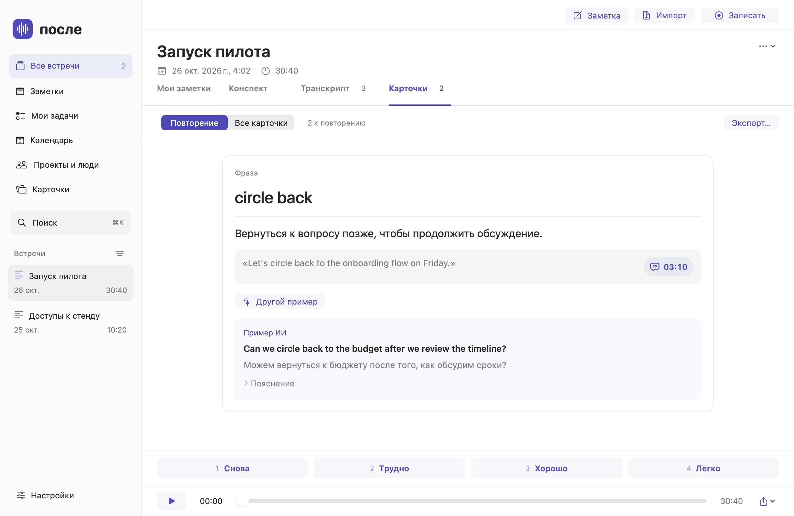</a>
<a href="docs/screenshots/calendar.png">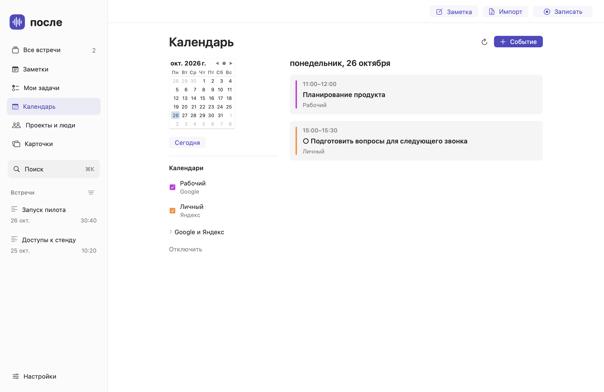</a>

**Смысловой поиск и трекеры:** находите выражение по приблизительному описанию; выбирайте, какие списки синхронизировать.

<a href="docs/screenshots/search-semantic.png">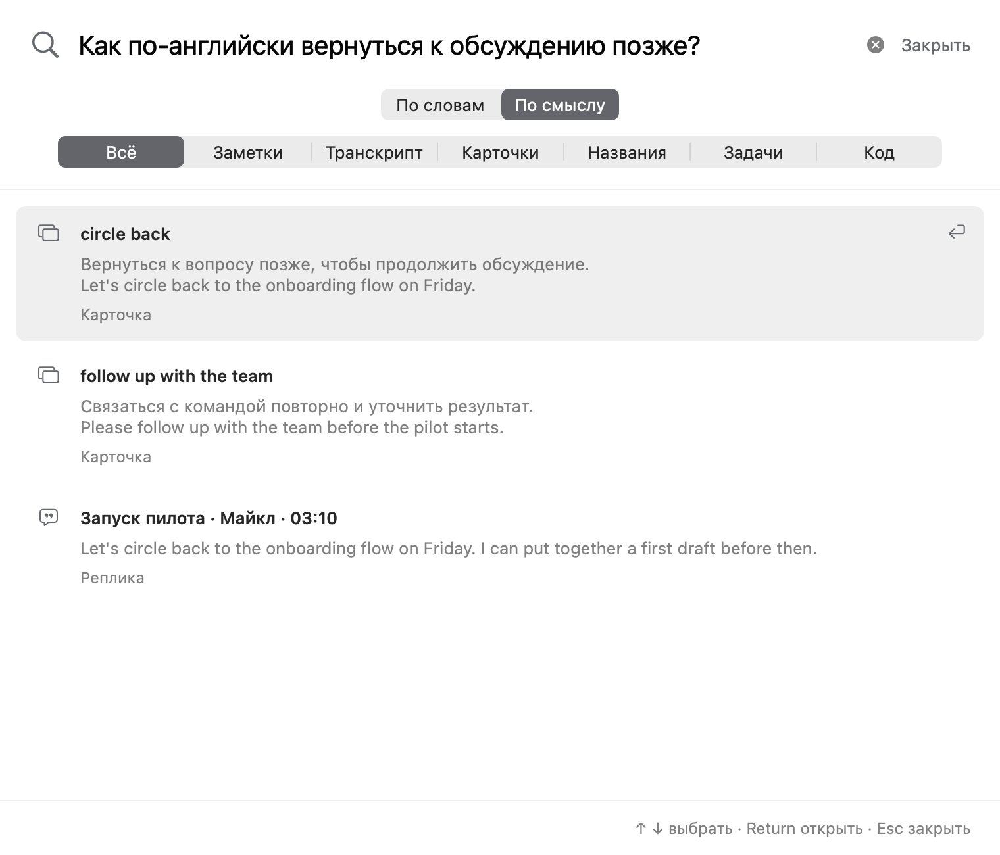</a>
<a href="docs/screenshots/tracker-sync.png">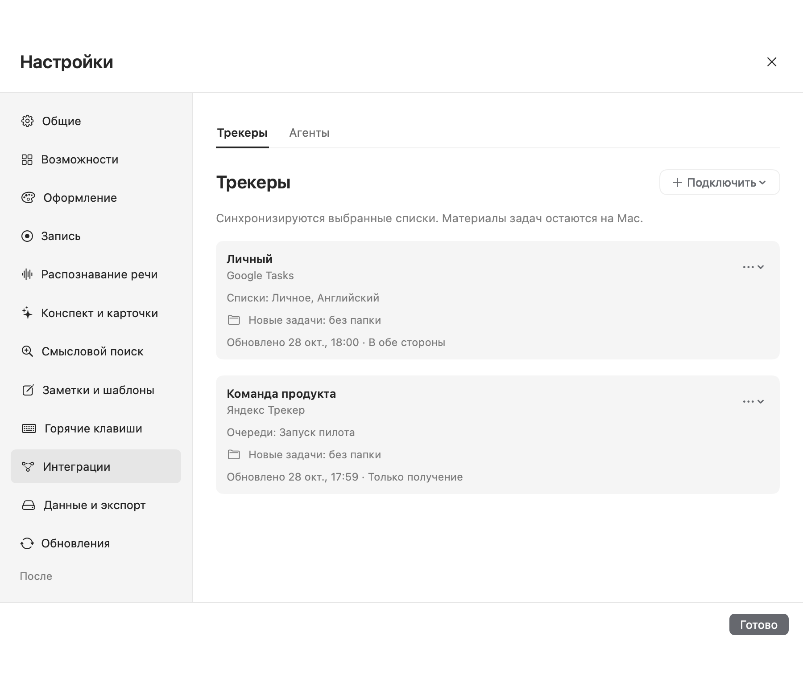</a>

Нажмите на изображение, чтобы открыть его целиком. На скриншотах — вымышленные встречи и заметки.
[Проекты и люди](docs/screenshots/contexts.png) · [Помощник с источниками](docs/screenshots/assistant.png) · [Голосовое поручение](docs/screenshots/voice.png) · [Все карточки](docs/screenshots/cards-library.png) · [Корзина](docs/screenshots/trash.png)

## Установка

1. Скачайте **Posle-Mac-AppleSilicon.pkg** из [Releases](https://github.com/starkovsavva/posle/releases).
2. Запустите установщик. Он обновит `/Applications/После.app` с сохранением библиотеки.
3. Выберите модели и нужные возможности в настройках: [первый запуск и подключения](docs/setup.md).

Следующие версии можно устанавливать из приложения: **Настройки → Обновления**.

Сборка без нотариализации Apple. Если macOS блокирует запуск, воспользуйтесь
[штатным разрешением запуска](https://support.apple.com/102445).

Записи и библиотека хранятся на Mac. При выборе облака аудио или текст отправляются
выбранному провайдеру. API оплачивается отдельно; ChatGPT использует лимиты подписки.
Ключи и сессии хранятся в Связке ключей macOS.

[Сборка и проверки](docs/development.md) · [Архитектура](docs/architecture.md) · [MIT](LICENSE) · [Сторонние компоненты](THIRD_PARTY.md)
