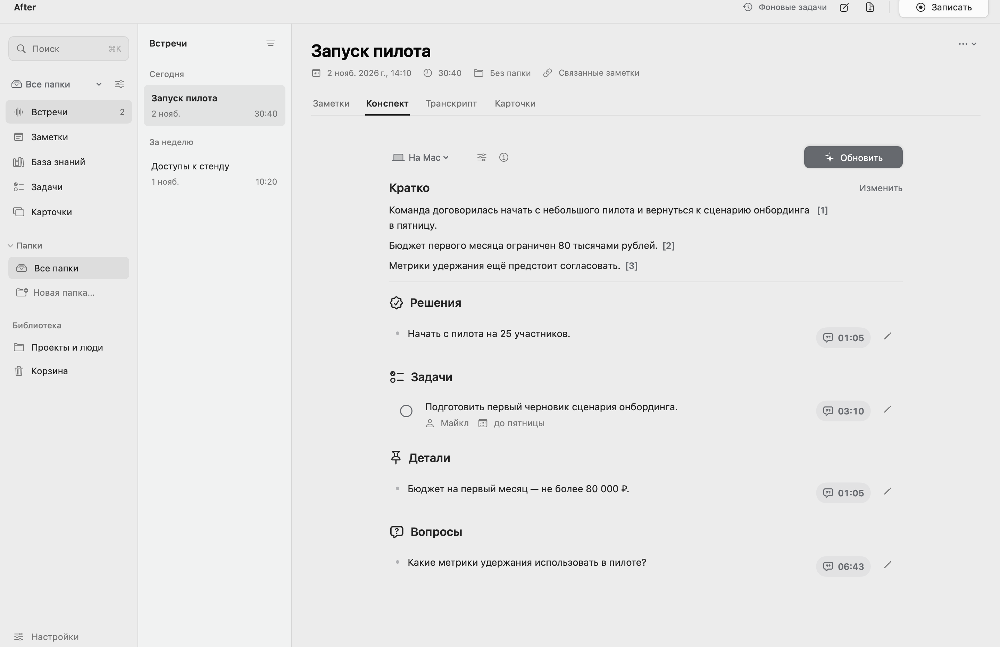
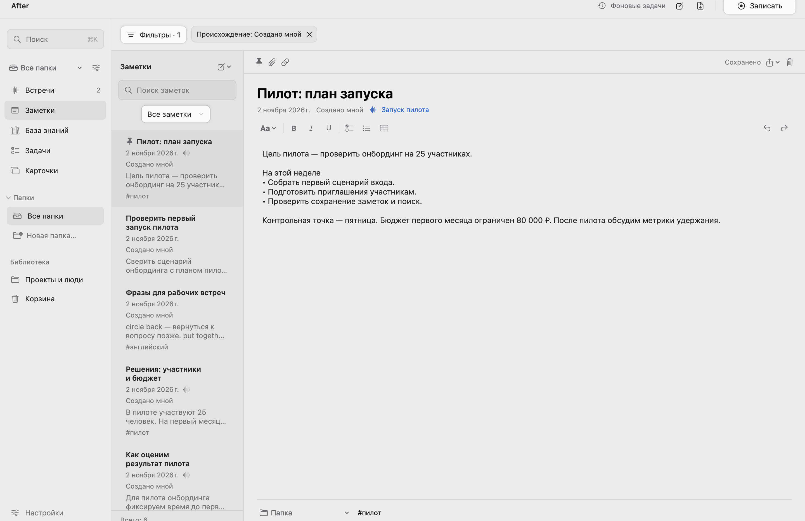
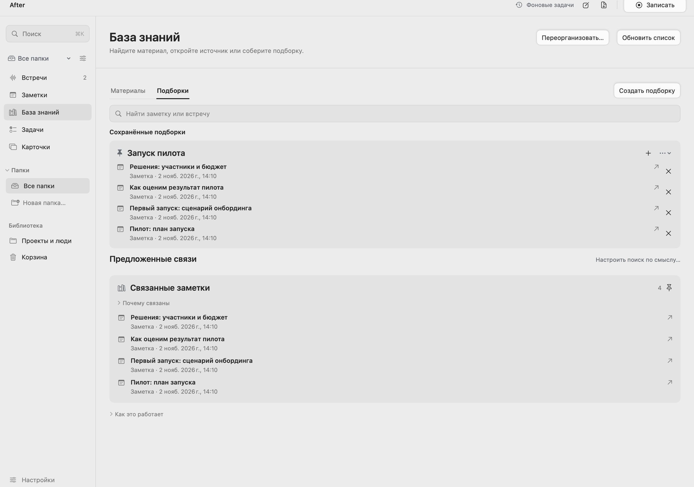
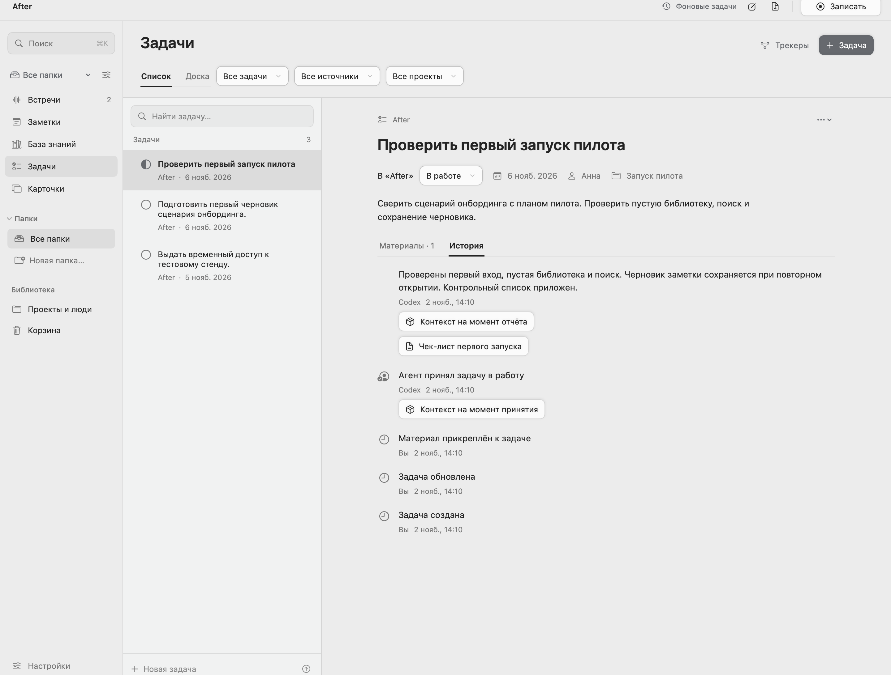
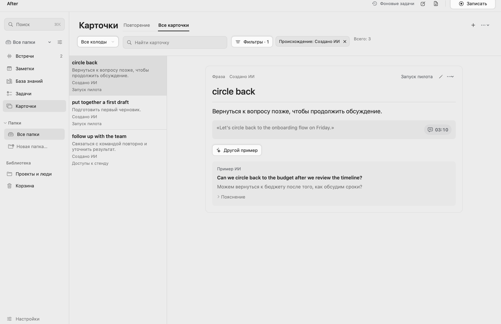

# After

Приложение для Mac: встречи, заметки, задачи и база знаний в одной библиотеке.
Сохраняйте решения и возвращайтесь к источнику, когда нужны подробности.

**[Скачать последнюю версию](https://github.com/starkovsavva/after/releases/latest)**
· Apple Silicon · macOS 15+ · RU / EN

**Встреча → конспект → источник.**
Запишите разговор или импортируйте аудио. After подготовит транскрипт и конспект:
решения, задачи и важные детали со ссылками на исходные реплики.
Название встречи и текст можно исправить после обработки.

**Заметки, которые легко найти.**
Записывайте свои мысли, сохраняйте важное из встреч, добавляйте вложения.
Поиск и совместные фильтры по происхождению, типу и теме помогают сузить список.
Происхождение — «Создано мной» или «Создано ИИ»; импорт входит в «Создано мной».
Условия можно убрать по одному; выбранные фильтры сохраняются.

**База знаний с контекстом.**
Собирайте встречи и заметки по темам и в подборки, связывайте материалы вручную.
Откройте найденную заметку или встречу, чтобы проверить подробности в источнике.

**Задача → разрешённый снимок → результат агента.**
Выберите заметки из базы знаний, проверьте снимок и подтвердите доступ.
Агент читает эту копию; отчёт, ссылки на источники и артефакты появляются
в истории задачи. Изменения оригиналов не меняют снимок; доступ можно отозвать.

**Карточки для повторения.**
Сохраняйте полезные фразы из встреч, редактируйте перевод и контекст.
Выберите колоду или отфильтруйте библиотеку и переходите к повторению по интервалам.

На снимках — вымышленные материалы. Нажмите на изображение, чтобы открыть целиком.

## Установка

1. Скачайте **.pkg** по ссылке выше и запустите установщик.
2. Выберите модели и нужные возможности: [первый запуск и подключения](docs/setup.md).
3. Следующие обновления доступны в **Настройки → Обновления**.

Сборка без нотариализации Apple. Если macOS блокирует запуск, используйте
[штатное разрешение запуска](https://support.apple.com/102445).

Записи и библиотека хранятся на Mac. Можно выбрать локальные модели или облако;
при работе с облаком аудио или текст отправляются выбранному провайдеру.
API оплачивается отдельно; подключение ChatGPT использует лимиты подписки.

Ключи и сессии хранятся в Связке ключей macOS.

[Модели и настройка](docs/setup.md) · [ChatGPT](docs/chatgpt.md) ·
[Сборка и проверки](docs/development.md) · [Разработка Linux-клиента](docs/linux.md) ·
[Архитектура](docs/architecture.md) · [MIT](LICENSE) · [Сторонние компоненты](THIRD_PARTY.md)
