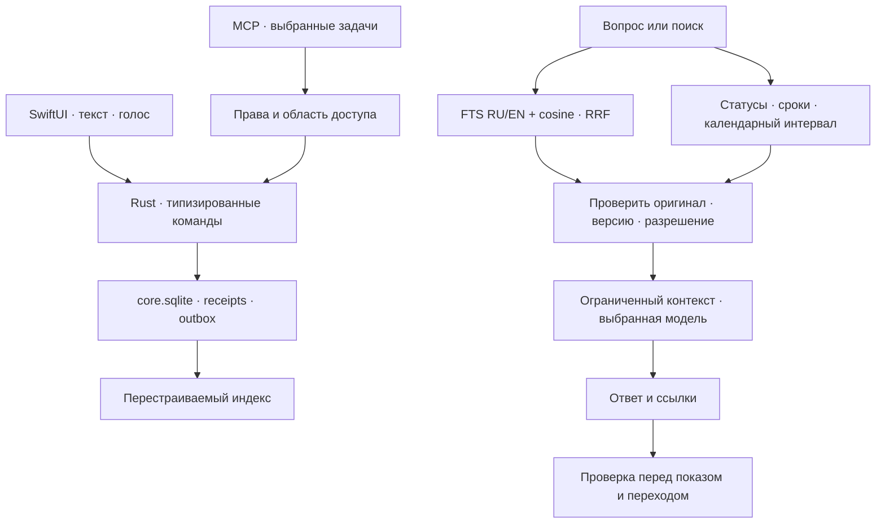

# База знаний и помощник

Архитектура 0.14.0. Нативный интерфейс SwiftUI, прикладное ядро Rust; целевой Mac — Apple Silicon с 16 ГБ памяти.

## Данные и операции

`core.sqlite` — источник истины для заметок, задач, материалов, истории, планов и результатов операций. Workspace хранится агрегатом; каталог сущностей, receipts и outbox — отдельными SQL-строками. Изменение агрегата, метаданных и событий фиксируется общей транзакцией с CAS, WAL и `synchronous=FULL`.

При первом открытии прежний `notes/workspace.json` импортируется один раз. Точные исходные байты сохраняются в `notes/workspace.pre-sqlite.json`. Последующий JSON — совместимый производный экспорт. Потерянная или повреждённая база не заменяется старым экспортом. Неизвестные поля сохраняются при обновлении известных сущностей.

Медиа, исходные транскрипты и конспекты встреч остаются файлами. Очередь обработки и перестраиваемые индексы используют отдельные SQLite-базы. Настройки и черновики не перенесены в canonical workspace. Связка ключей хранит секреты.

UI, голос и MCP используют одни команды домена. Запись проверяет версию объекта и ID операции. Повтор возвращает сохранённый результат; Undo проверяет последующие изменения. MCP получает только явно разрешённые задачи и материалы.

## Получение контекста

`knowledge.rs` объединяет встречи, реплики, конспекты, карточки, заметки, задачи и явно индексируемые папки. Даты, статусы и текущие свойства вычисляет домен. Сведения календаря передаются временным разрешённым снимком; embeddings календаря не сохраняются.

Текстовый и векторный результаты объединяются по рангам RRF, без сложения BM25 и cosine. Векторный индекс хранит нормализованные векторы и manifest: провайдер, адрес, модель, revision/digest, размерность, шаблоны query/document и версия chunker. Поколения переключаются транзакционно; разные модели не смешиваются. При недоступности embeddings остаётся текстовый поиск.

Ollama и LM Studio предоставляют локальные embeddings; совместимый HTTPS API требует отдельного согласия. Начальная модель — `qwen3-embedding:0.6b`. Индекс строится небольшими пакетами с контрольными точками, уступая записи, обработке и тепловым ограничениям. SQLite хранит векторы; поиск cosine ограничен размером локального корпуса. Отдельные Redis, Celery и сервер векторной БД не нужны.

Каждый источник содержит ID, маршрут и fingerprint. Перед выдачей перечитываются оригинал и разрешения. Устаревшие производные источники исключаются; legacy-конспекты без версии транскрипта помечаются. Фоновая операция не может вернуть удалённый объект или отозванный материал. Outbox помогает обновлять индекс; сверка manifest остаётся обязательной при запуске и восстановлении.

## Папки и облако

Прикрепление папки само по себе не включает обход. Индексация разрешается у конкретного материала. Обход учитывает `.gitignore`, `.posleignore`, скрытые и служебные файлы, секреты, ограничения количества и объёма. Symlink-переходы за корень запрещены. Источник содержит относительный путь и диапазон строк; открытие заново проверяет разрешение и содержимое файла.

Локальный поиск и отправка кода в облачную модель — разные разрешения. Тексты папки не должны попадать в облачные embeddings или ответ без соответствующего согласия. Ключ embeddings закрепляется за fingerprint конфигурации; смена адреса не переносит на него прежний ключ. Очередь не сохраняет секреты.

## Помощник

Классификатор возвращает типизированное действие. Вопрос выполняет поиск и синтез ответа; команда изменения получает существующие ID и проверяемый план. Открытие карточки, заметки или встречи выбирает только реально найденные маршруты. Несколько вариантов показывает пользовательский выбор.

Уточнение хранит ограниченные предыдущие вопросы пользователя для восстановления темы. Старые ответы не считаются фактами и старые команды не повторяются. Перед каждым ответом источники и календарные права обновляются. Бюджет контекста совместимого локального JSON-контура — менее 19.4 КБ вместе со схемой и инструкцией.

Инструкции внутри материалов — данные. Модель не формирует файловые пути или произвольные команды компьютера. Проверка ссылки подтверждает существование и свежесть источника, но сама по себе не доказывает поддержку всех утверждений ответа.

## Внешние трекеры

Google Tasks и Яндекс Трекер подключаются явно, отдельно от системного календаря. Фоновый обмен получает все страницы выбранных списков до применения изменений. Постоянные ID сопоставляют копии; ETag/версия защищают внешние записи. Одновременные изменения и удаления требуют видимого разрешения конфликта.

Provider journal сохраняет намерение перед сетевой записью; canonical импорт сохраняет receipt вместе с workspace. После неопределённого сетевого результата выполняется сверка. Google не имеет create idempotency key: непроверенное создание повторно не отправляется. Подробности подключения и ограничений — в [инструкции](tracker-sync.md).

## Перенос между устройствами: следующий этап

DocumentDB не включён в 0.14.0. Amazon DocumentDB и open-source DocumentDB — серверные системы; они не заменяют протокол синхронизации офлайн-копий. Для текущего приложения сохраняем SQLite и рассматриваем переносимый `poslearchive`: вся библиотека либо выбранные проекты, папки и колоды.

Пакет должен включать manifest версии, устойчивые ID и checksum файлов. Предпросмотр показывает связанные материалы; карточка не должна автоматически захватывать всю исходную встречу. Ключи, аккаунты, активные jobs/claims, receipts/outbox и разрешения MCP/облака не переносятся. Импорт сначала проверяет пакет в staging, затем предлагает объединить, сохранить обе версии или создать отдельную библиотеку. Повторный импорт не создаёт дубликаты.

Технический backup SQLite и логический пакет для объединения — разные операции. Backup API фиксирует базу, но для медиа нужна дополнительная фиксация версий. Живая WAL-база не помещается в папку облачной файловой синхронизации. Автоматический обмен позже добавляется адаптером с deviceID, operationID, cursors, tombstones и конфликтами по сущностям.

Для Apple-only подходит CloudKit/CKSyncEngine, но его включение требует Apple Developer Program и соответствующих entitlements. Сейчас такого аккаунта у владельца нет. Экспорт через AirDrop или облачную папку не требует подключения CloudKit.

Источники: [Amazon DocumentDB](https://docs.aws.amazon.com/documentdb/latest/devguide/what-is.html), [open-source DocumentDB](https://documentdb.io/docs/getting-started/), [SQLite Backup API](https://sqlite.org/backup.html), [включение CloudKit](https://developer.apple.com/documentation/cloudkit/enabling-cloudkit-in-your-app).

## Проверки

Проверяются миграция и повреждение базы, CAS и повторы, crash recovery, отзыв доступа, изменённые источники, смена модели и адреса с ключом, пагинация и потерянный ответ провайдера. Нативные сценарии используют временные библиотеки и локальные HTTP-стенды. Реальный доступ к пользовательским аккаунтам не нужен для тестов протокола.

Качество multilingual retrieval и скорость на Air M5 требуют отдельных замеров. Фикстуры векторов проверяют вычисления и протокол, а не качество embedding-модели. Приватные тексты не записываются в диагностические логи.

Основание: [SQLite FTS5](https://www.sqlite.org/fts5.html), [SQLite transactions](https://www.sqlite.org/lang_transaction.html), [Ollama embeddings](https://docs.ollama.com/capabilities/embeddings), [Qwen3 Embedding](https://huggingface.co/Qwen/Qwen3-Embedding-0.6B), [Google Tasks](https://developers.google.com/workspace/tasks/reference/rest), [Яндекс Трекер](https://yandex.ru/support/tracker/ru/api/about-api).
