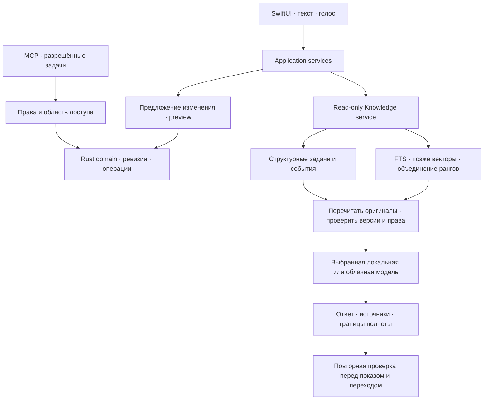

# База знаний и помощник

Рабочее архитектурное решение, 27 октября 2026. Rust + SwiftUI, Mac с 16 ГБ памяти.
Разделы «Сейчас» описывают код; «Следующий этап» — ещё не реализованные изменения.

## Основное решение

Оригиналы приложения образуют базу знаний. Индекс помогает найти оригиналы;
модель получает ограниченную подборку актуальных источников и составляет ответ.
Статусы, сроки, количество задач и интервалы календаря вычисляются доменом.

Вопрос не выполняет операции записи. Изменение проходит через типизированную команду
Rust с проверкой ревизии, idempotency key, журналом результата и восстановлением.
UI, голос и MCP используют один домен задач. Универсальный поиск не расширяет MCP:
ему по-прежнему доступны только явно разрешённые задачи и материалы.

## Сейчас

- Встречи и заметки — canonical JSON; очередь и поисковый индекс — SQLite.
- `knowledge.rs` собирает источники встреч, конспектов, карточек, заметок и задач;
  календарь передаётся как временный снимок уже подключённых видимых календарей.
- Retrieval использует RU/EN FTS и структурные данные. Несколько запросов выполняются
  одним batch с одной синхронизацией индекса; ранги сохраняются при объединении.
- В контекст входят подобранные фрагменты, а не вся библиотека. Текущий бюджет
  совместимости локального JSON-контура — менее 19.4 КБ вместе со схемой и инструкцией.
- Источник содержит стабильный ID, маршрут к оригиналу и fingerprint. Устаревшие
  производные тексты исключаются. Legacy-конспекты без версии транскрипта отмечаются.
- Очередь сохраняет запрос вопроса без календарного снимка. Перед каждой попыткой,
  включая History Retry, события, права и время обновляются на native стороне.
- Подготовка вопроса и синтез ответа разделены: classifier не получает календарь;
  перед синтезом Swift заново получает разрешённый календарный снимок.
- Ответ проверяет существование и свежесть ссылок. Это не доказывает логическую
  поддержку текста модели: качество подтверждается отдельными RU/EN evals.
- Нет прав на календарь или есть усечение — это явно сообщается. Отсутствие доступных
  событий не превращается в утверждение «встреч нет». Папки и репозитории не обходятся.

## Следующий этап: гибридный поиск

Векторный индекс пока не реализован. Он дополнит FTS для перефразировок и поиска
между русским и английским. Точные имена, числа и идентификаторы остаются в FTS;
даты и статусы — в структурных запросах. Нельзя складывать BM25 и cosine напрямую:
используем объединение рангов, затем читаем выбранные оригиналы.

Компактную multilingual embedding-модель выбираем по собственному RU/EN набору.
Один экземпляр модели, небольшие пакеты, пауза при записи, ASR и memory pressure.
Ни отдельный сервер векторной БД, ни Redis/Celery для локального приложения не нужны.
[sqlite-vec](https://github.com/asg017/sqlite-vec) — кандидат для проверки совместимости,
лицензии и закреплённой сборки, а не уже принятая зависимость.

`SourceDocument` хранит `sourceID`, `sourceVersion`, `contentHash`, provenance, даты,
права и структурные поля. Chunk сохраняет связь с segment/card/note/task/attachment.
Embedding manifest фиксирует model revision/checksum, размерность, нормализацию,
query/document template и версию chunker. Разные поколения векторов не смешиваются.
Новый индекс строится в фоне и переключается атомарно; при ошибке доступен FTS.

Удаление и отзыв доступа сразу запрещают выдачу. Tombstone и проверка версии
не дают запоздавшей фоновой операции вернуть удалённый документ.
Календарь на первом этапе остаётся временным, без постоянных embeddings.

## Хранение без большого переписывания

Сначала фиксируем repository boundaries и версии, сохраняя текущие данные.
Следующая оптимизация — отдельный лёгкий вход вопросов без выбранного документа в classifier;
синтез остаётся одним model call по проверенным источникам.
Затем поэтапно переносим изменяемые notes/tasks/history/receipts в `core.sqlite`.
Медиа и транскрипты могут остаться файлами; JSON сохраняется для импорта и экспорта.
`knowledge.sqlite` — отдельный перестраиваемый индекс, не второй источник истины.

Пока canonical данные в JSON, уведомления об изменениях дополняются обязательной
сверкой manifest при запуске и восстановлении. Запись в отдельный SQLite outbox
не атомарна с заменой JSON. Настоящий transactional outbox вводится вместе с общей
SQL-транзакцией изменения сущности; до этого не называем доставку атомарной.

## Проверки перед выпуском

1. Правка транскрипта «10 → 20» не позволяет старому конспекту вернуть «10» как факт.
2. Изменение события, скрытие календаря и отзыв прав во время ответа удаляют
   соответствующие утверждения целиком, включая смешанные абзацы.
3. Удаление и правка между поиском, ответом и переходом не открывают устаревший источник.
4. Совпадение в конце длинного описания действительно попадает в контекст.
5. Чужие citation IDs и инструкции внутри заметки не становятся маршрутами и командами.
6. Повтор, конфликт ревизий, сбой между commit и receipt и Undo сохраняют данные.
7. RU/EN evals отдельно измеряют retrieval recall, подтверждённость ответа, отсутствие
   ответа и точность структурных вопросов. Моки протокола не заменяют проверку модели.

Замеряем время retrieval, model call и полного ответа, объём контекста и индекса.
Сырые тексты личных материалов не записываем в диагностические логи.
Скорость и память на Air M5 подтверждаются замером на устройстве.

Основание: независимый review текущего кода;
[SQLite FTS5](https://www.sqlite.org/fts5.html),
[Sentence Transformers: Retrieve & Re-Rank](https://www.sbert.net/examples/sentence_transformer/applications/retrieve_rerank/README.html).
