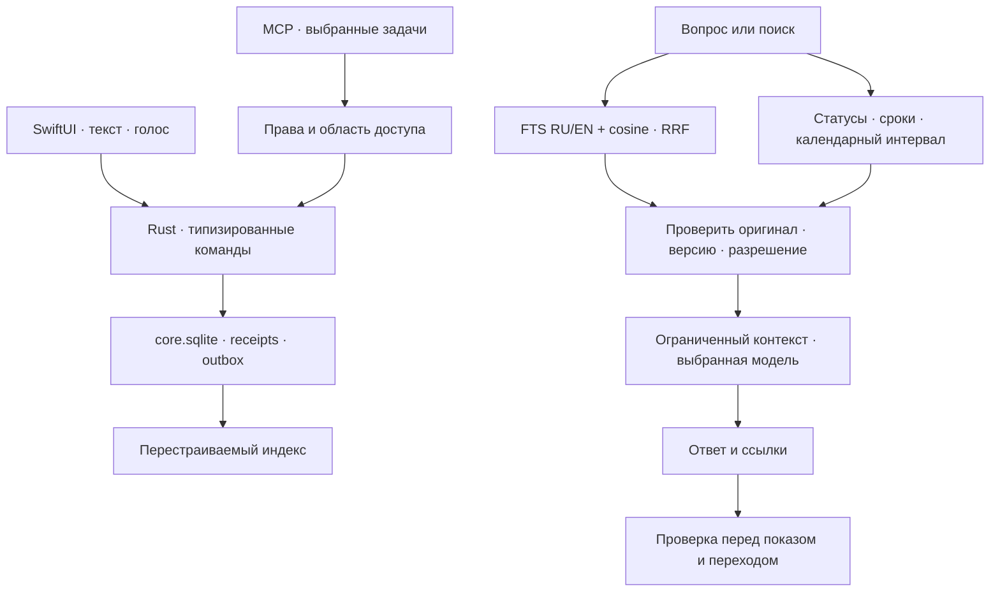

# База знаний и помощник

Архитектура 0.17.5. Нативный интерфейс SwiftUI, прикладное ядро Rust; целевой Mac — Apple Silicon с 16 ГБ памяти.

## Необязательные возможности

`AppSettings.features` хранит независимые флаги карточек, задач/проектов, календаря,
помощника и смыслового поиска. Отсутствующие поля старых настроек означают `false`.
Встречи, заметки, конспекты, транскрипты и поиск по словам остаются базовыми.

Общие флаги и профили папок определяют навигацию, команды, настройки, контекст
помощника и запуск фоновой работы. Скрытая вкладка или глубокая ссылка не включает возможность
сама: интерфейс предлагает открыть настройки. Переключатель сначала атомарно
сохраняет настройки и лишь затем меняет состояние интеграций; ошибка записи
оставляет прежний выбор действующим. Отключение не удаляет содержимое
библиотеки, историю, ключи или выбранные модели. Уже сохранённые подключения не
становятся согласием на работу выключенной возможности.

Генерация карточек дополнительно учитывает `meeting.generateCards`: явный выбор
встречи имеет приоритет над `folder.overrides.generateCards`; отсутствие обоих
означает `false`. Эффективная возможность карточек также должна быть включена.
Конспект без карточек не меняет существующую колоду и интервалы повторений.
Параметры проверяются повторно перед публикацией результата, чтобы изменение
выбора во время запроса не перезаписало данные неожиданным результатом.

## Папки и профили

`NotesWorkspace.folders` хранит устойчивые ID, имя, revision и разреженные
`overrides`. `MeetingContext.folderID` связывает встречу с папкой;
`CapturedNote.folderID` связывает самостоятельную заметку или задачу.
Папки существуют независимо от содержимого и проектов. Старые строковые папки
заметок мигрируют в устойчивые сущности; приложение не угадывает папку встречи
по названию проекта или заметки.

Профиль вычисляется как общие настройки → заданные поля папки. Отсутствие поля
или `null` означает наследование, а `false` явно выключает возможность.
Профиль выбирает язык, приоритеты и контекст конспекта, режим обработки,
локального/облачного провайдера, модель и не содержащие секретов параметры API.
Ключи остаются в Keychain и закреплены за выбранным провайдером и адресом.
Папка не копирует модель или аккаунт и не меняет разрешения macOS.
Непустой `meeting.focus` имеет приоритет над фокусом профиля; пустое значение
возвращает наследование. Явный выбор `meeting.generateCards` также сохраняется
при переносе встречи и удалении её папки.

`profile-resolve` возвращает эффективную область, флаги `features` и fingerprint настроек.
Очередь закрепляет выбранную папку и профиль; перед запросом и публикацией
проверяет их актуальность. Поздний результат старой модели не заменяет данные
после смены профиля. UI, голос и MCP используют одинаковое разрешение профиля.

Навигация выбранной папки показывает её встречи, заметки, задачи и колоды.
«Все папки» сохраняет общий обзор и объединяет доступные возможности.
Фоновые службы учитывают возможности всех папок, а конкретная операция
проверяет профиль своего объекта. Календари, установленные модели и сохранённые
подключения остаются общими ресурсами приложения. Подключение трекера отдельно
проверяет профиль своей папки назначения до обновления OAuth-токена и обмена
данными; включение задач в другой папке не разрешает это подключение.

Изменение папки использует CAS в canonical workspace. Удаление отвязывает
содержимое, сохраняя сами материалы, и возвращает наследование от приложения.
Сохранённые переопределения самой встречи не сбрасываются.
Создание отдельной колоды и импорт карточек проверяют папку до публикации
метаданных. Конфигурация трекера хранит `folderID` для новых импортированных
задач; смена назначения не перемещает прежние задачи.

## Вкладки интерфейса

`AppTabBar` — общий компонент навигации по связанным представлениям. Он использует семантические цвета `Ink` и типографику `AppTypography`: текстовые названия, видимое подчёркивание выбранного раздела и общую нижнюю линию. `Binding` остаётся у экрана, поэтому смена оформления не меняет источник состояния, черновики и проверки возможностей. Стабильные идентификаторы доступны нативным UI-проверкам.

Паттерн используется во встречах, интеграциях, списке и доске задач, повторении карточек, календаре, проектах и поиске. Выбор параметра в форме остаётся отдельным типом контрола. Семантика разделяет переключение содержимого и действие над ним, как рекомендуют [Apple HIG для вкладок](https://developer.apple.com/design/human-interface-guidelines/tab-views) и [сегментированных контролов](https://developer.apple.com/design/human-interface-guidelines/segmented-controls).

## Данные и операции

`core.sqlite` — источник истины для папок и их профилей, привязок встреч, заметок, задач, материалов, истории, планов и результатов операций. Workspace хранится агрегатом; каталог сущностей, receipts и outbox — отдельными SQL-строками. Изменение агрегата, метаданных и событий фиксируется общей транзакцией с CAS, WAL и `synchronous=FULL`.

При первом открытии прежний `notes/workspace.json` импортируется один раз. Точные исходные байты сохраняются в `notes/workspace.pre-sqlite.json`. Последующий JSON — совместимый производный экспорт. Потерянная или повреждённая база не заменяется старым экспортом. Неизвестные поля сохраняются при обновлении известных сущностей.

Медиа, исходные транскрипты и конспекты встреч остаются файлами. Очередь обработки и перестраиваемые индексы используют отдельные SQLite-базы. Общие настройки приложения и черновики редакторов не перенесены в canonical workspace. Связка ключей хранит секреты.

Перетаскивание задачи между колонками вызывает обычный `task-details-update`, сохраняя CAS и историю. Приватная ссылка переноса действует только в текущем процессе и доске; перед записью ядро под блокировкой проверяет `expectedTaskFolderID` и действующий профиль папки. Для доски по умолчанию видны все статусы, фильтр списка хранится отдельно.

UI, голос и MCP используют одни команды домена. Изменения workspace используют CAS; журналируемые операции также сохраняют ID повтора. Повтор возвращает сохранённый результат; Undo проверяет последующие изменения. MCP получает только явно разрешённые задачи и материалы.

## Получение контекста

`knowledge.rs` объединяет встречи, реплики, конспекты, карточки, заметки, задачи и явно индексируемые папки. Даты, статусы и текущие свойства вычисляет домен. Сведения календаря передаются временным разрешённым снимком; embeddings календаря не сохраняются.

Текстовый и векторный результаты объединяются по рангам RRF, без сложения BM25 и cosine. Векторный индекс хранит нормализованные векторы и manifest: провайдер, адрес, модель, revision/digest, размерность, шаблоны query/document и версия chunker. Поколения переключаются транзакционно; разные модели не смешиваются. При недоступности embeddings остаётся текстовый поиск.

Ollama и LM Studio предоставляют локальные embeddings; совместимый HTTPS API требует отдельного согласия. Начальная модель — `qwen3-embedding:0.6b`. Индекс строится небольшими пакетами с контрольными точками, уступая записи, обработке и тепловым ограничениям. SQLite хранит векторы; поиск cosine ограничен размером локального корпуса. Отдельные Redis, Celery и сервер векторной БД не нужны.

Каждый источник содержит ID, маршрут и fingerprint. Перед выдачей перечитываются оригинал и разрешения. Устаревшие производные источники исключаются; legacy-конспекты без версии транскрипта помечаются. Фоновая операция не может вернуть удалённый объект или отозванный материал. Outbox помогает обновлять индекс; сверка manifest остаётся обязательной при запуске и восстановлении.

## Папки и облако

Прикрепление папки само по себе не включает обход. Индексация разрешается у конкретного материала. Обход учитывает `.gitignore`, `.posleignore`, скрытые и служебные файлы, секреты, ограничения количества и объёма. Symlink-переходы за корень запрещены. Источник содержит относительный путь и диапазон строк; открытие заново проверяет разрешение и содержимое файла.

Локальный поиск и отправка кода в облачную модель — разные разрешения. Тексты папки не должны попадать в облачные embeddings или ответ без соответствующего согласия. Ключ embeddings закрепляется за fingerprint конфигурации; смена адреса не переносит на него прежний ключ. Очередь не сохраняет секреты.

## Помощник

Классификатор возвращает типизированное действие. Вопрос выполняет поиск и синтез ответа; команда изменения получает существующие ID и проверяемый план. Открытие карточки, заметки или встречи выбирает только реально найденные маршруты. Несколько вариантов показывает пользовательский выбор.

Уточнение хранит ограниченные предыдущие вопросы пользователя для восстановления темы. Старые ответы не считаются фактами и старые команды не повторяются. Перед каждым ответом источники и календарные права обновляются. Бюджет контекста совместимого локального JSON-контура — менее 19.4 КБ вместе со схемой и инструкцией.

Инструкции внутри материалов — данные. Модель не формирует файловые пути или произвольные команды компьютера. Проверка ссылки подтверждает существование и свежесть источника, но сама по себе не доказывает поддержку всех утверждений ответа.

## Внешние трекеры

Google Tasks и Яндекс Трекер подключаются явно, отдельно от системного календаря. Фоновый обмен получает все страницы выбранных списков до применения изменений. Постоянные ID сопоставляют копии; ETag/версия защищают внешние записи. Одновременные изменения и удаления требуют видимого разрешения конфликта.

Provider journal сохраняет намерение перед сетевой записью; canonical импорт сохраняет receipt вместе с workspace. После неопределённого сетевого результата выполняется сверка. Google не имеет create idempotency key: непроверенное создание повторно не отправляется. Подробности подключения и ограничений — в [инструкции](tracker-sync.md).

## Перенос между устройствами: следующий этап

В 0.17.0 нет автоматической синхронизации устройств и пакетного импорта/экспорта выбранных папок. DocumentDB не включён. Amazon DocumentDB и open-source DocumentDB — серверные системы; они не заменяют протокол синхронизации офлайн-копий. Для текущего приложения сохраняем SQLite и рассматриваем переносимый `poslearchive`: вся библиотека либо выбранные проекты, папки и колоды.

Проверка DocumentDB в 0.17.5 не подтвердила преимущество по скорости для текущей нагрузки: сравнимый benchmark ещё не проводился. [Open-source DocumentDB](https://documentdb.io/docs/getting-started/) — сервер на PostgreSQL/BSON (на Mac запускается через Docker), [Amazon DocumentDB](https://docs.aws.amazon.com/documentdb/latest/devguide/how-it-works.html) — облачный кластер. SQLite поддерживает [JSON/JSONB](https://www.sqlite.org/json1.html) и индексы выражений. В текущем `workspace_repository.rs` при изменении сущности обрабатывается агрегат workspace и обновляется совместимый JSON-экспорт; прежде чем менять движок, нужно измерить этот путь и сравнить отдельные SQL-строки/индексы для папок, статусов и дат. Импорт/экспорт пакетов и синхронизация офлайн-изменений требуют собственного протокола независимо от движка.

Пакет должен включать manifest версии, устойчивые ID и checksum файлов. Предпросмотр должен показывать связанные материалы; карточка не должна автоматически захватывать всю исходную встречу. Ключи, аккаунты, активные jobs/claims, receipts/outbox и разрешения MCP/облака не переносятся. Планируемый импорт должен сначала проверять пакет в staging, затем предлагать объединить, сохранить обе версии или создать отдельную библиотеку. Повторный импорт не должен создавать дубликаты.

Технический backup SQLite и логический пакет для объединения — разные операции. Backup API фиксирует базу, но для медиа нужна дополнительная фиксация версий. Живая WAL-база не помещается в папку облачной файловой синхронизации. Автоматический обмен позже добавляется адаптером с deviceID, operationID, cursors, tombstones и конфликтами по сущностям.

Для Apple-only подходит CloudKit/CKSyncEngine, но его включение требует Apple Developer Program и соответствующих entitlements. Сейчас такого аккаунта у владельца нет. Экспорт через AirDrop или облачную папку не требует подключения CloudKit.

Источники: [Amazon DocumentDB](https://docs.aws.amazon.com/documentdb/latest/devguide/what-is.html), [open-source DocumentDB](https://documentdb.io/docs/getting-started/), [SQLite Backup API](https://sqlite.org/backup.html), [включение CloudKit](https://developer.apple.com/documentation/cloudkit/enabling-cloudkit-in-your-app).

## Проверки

Проверяются миграция и повреждение базы, CAS и повторы, crash recovery, отзыв доступа, изменённые источники, смена модели и адреса с ключом, пагинация и потерянный ответ провайдера. Нативные сценарии используют временные библиотеки и локальные HTTP-стенды. Реальный доступ к пользовательским аккаунтам не нужен для тестов протокола.

Качество multilingual retrieval и скорость на Air M5 требуют отдельных замеров. Фикстуры векторов проверяют вычисления и протокол, а не качество embedding-модели. Приватные тексты не записываются в диагностические логи.

Основание: [SQLite FTS5](https://www.sqlite.org/fts5.html), [SQLite transactions](https://www.sqlite.org/lang_transaction.html), [Ollama embeddings](https://docs.ollama.com/capabilities/embeddings), [Qwen3 Embedding](https://huggingface.co/Qwen/Qwen3-Embedding-0.6B), [Google Tasks](https://developers.google.com/workspace/tasks/reference/rest), [Яндекс Трекер](https://yandex.ru/support/tracker/ru/api/about-api).

### Восстановимые действия и контекст конспектов

Удаление заметок и задач сохраняет дату в SQLite, отдельные карточки архивируются в колоде, встреча целиком переносится в приватную `trash/meetings`. Восстановление ограничено 30 днями. Операции проверяют текущую версию и сохраняют идентификатор повтора; перемещение встречи восстанавливается по файловому маркеру при сбое до записи SQL-квитанции. Истёкшие объекты очищаются в фоне; для задач из конспекта остаётся минимальная метка источника, предотвращающая повторное появление. Независимые заметки остаются во входящих.

Массовая правка карточек использует реальные ID, ограниченные порции контекста и предпросмотр до подтверждения. Журнал фиксируется до публикации колод; повтор и восстановление после сбоя используют тот же состав изменений. Меняется содержимое сторон, а не ID и прогресс повторений.

Профиль пользователя и цель встречи — необязательные данные для выбора приоритетов конспекта. Они не считаются доказательствами и не разрешают выполнять инструкции из транскрипта. Подготовка MP3 выполняется Rust-процессом с отдельно проверенным FFmpeg и не зависит от доверия к установленному Python.
