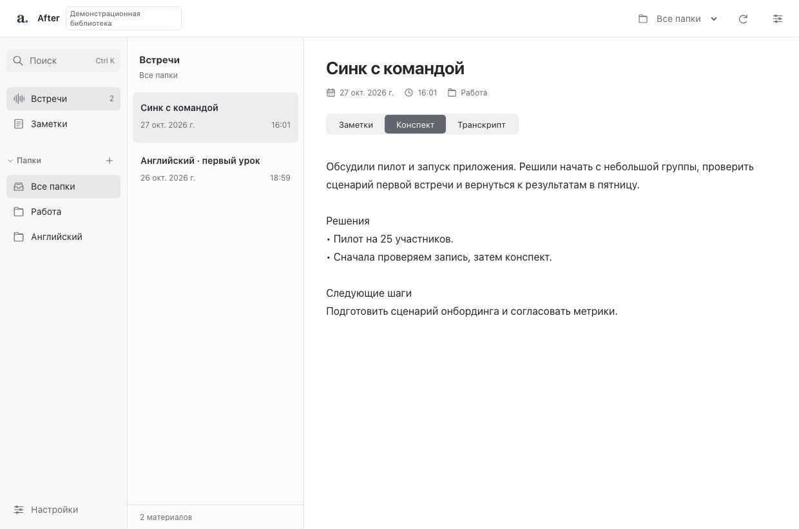
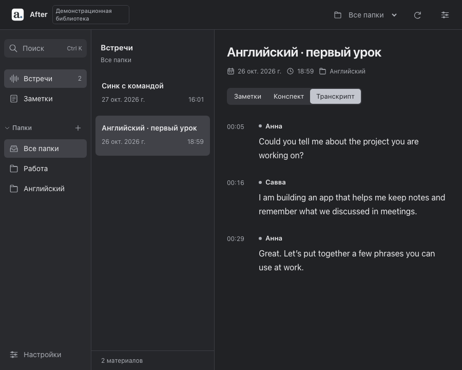

# After: общий desktop-клиент

Tauri 2, React/TypeScript и существующее Rust-ядро. Разработка ведётся отдельно от стабильного SwiftUI-клиента, в `codex/after-windows-preview` на основе `codex/cross-platform`. Номер `0.1.1` у оболочки — версия тестового прототипа, не новый релиз основной программы. Название After одинаково в русском и английском интерфейсе; иконка соответствует текущему светлому знаку Mac-клиента.

## Что уже переносится

- Общая библиотека встреч и заметок, папки с созданием и переименованием.
- Просмотр сохранённых конспектов и транскриптов с именами говорящих.
- Создание и редактирование обычного текста заметок с сохранением через канонический SQLite-репозиторий, проверкой версии и сохранением вложений/скрытых полей.
- Текстовый поиск по заметкам и встречам в выбранной папке.
- Русский/английский интерфейс, язык системы по умолчанию, светлая/тёмная тема, скрытие списка папок, защита несохранённого черновика.

Запись, распознавание, генерация конспекта, помощник, календарь, задачи, карточки и настройки моделей в эту первую оболочку ещё не перенесены. Пустые активные кнопки для них не показываются. Профили папок сохраняются ядром, но редактор профилей и их функциональные вкладки появятся в следующих срезах. Это прототип миграции, а не замена установленного клиента.

## Вид интерфейса

Tauri preview с синтетической демонстрационной библиотекой. Личные данные не подключены.





## Границы

Webview вызывает только `get_workspace`, `get_meeting`, `save_note`, `save_folder`, `search_library`. Tauri исполняет эти операции вне UI-потока через фиксированный `posle-engine desktop-bridge`; командная оболочка не используется. Корень данных, путь процесса и произвольные команды из JavaScript не принимаются. IPC ограничен локальным главным окном. Контент отображается как текст; HTML из заметок не исполняется.

Движок сохраняет доменные проверки, блокировки, CAS и транзакции существующего приложения. Штатный ресурс движка проверяется по SHA-256, встроенному во время сборки. Это проверка целостности, не подпись издателя; релизная подпись и обновления ещё не настроены. В release переменные переопределения пути игнорируются.

У клиента собственный идентификатор `app.posle.desktop` и отдельная папка `appLocalDataDir`. Он не открывает автоматически живую библиотеку старого приложения. Отладочные `AFTER_DATA_DIR` и `AFTER_ENGINE_PATH` допускаются только в debug; указывать следует копию данных, не библиотеку работающего клиента. Автоматическая синхронизация и импорт/экспорт из нового UI пока не подключены.

Общий frontend и host рассчитаны на три ОС. Ветка `codex/after-windows-preview` подготавливает отдельный Windows x64 installer с рабочим движком библиотеки. Windows-прогон ядра, проверка упакованного приложения и сборка установщика должны завершиться успешно до передачи файла тестировщику. Поддержка системных функций Windows и Linux из этого не следует; стабильный Mac-клиент остаётся отдельным приложением.

## Тестовая Windows x64-сборка

Тестовая оболочка использует собственную локальную библиотеку; личные встречи или ключи разработчика в неё не входят. Публичный релиз и автоматические обновления этой версии не публикуются. Тестовый артефакт предназначен для проверки на компьютере Intel/AMD с Windows 10/11; ARM64 и Linux этим установщиком не проверяются.

При первом запуске:

1. Создайте заметку кнопкой **Новая заметка** в пустой библиотеке.
2. Создайте папку кнопкой **+** возле Папок, сохраните в ней заметку и переименуйте папку.
3. Измените текст заметки, сохраните через **Ctrl+S**, закройте и снова откройте приложение — текст и папка должны сохраниться.
4. Найдите заметку через **Ctrl+K**. Сочетания с Alt/Shift не запускают этот поиск.
5. Проверьте русский/английский интерфейс и светлое/тёмное оформление в настройках. Название After и исходный язык материалов сохраняются.
6. Попробуйте уйти из несохранённой заметки: можно продолжить редактирование, сохранить или явно отказаться от изменений.

Записи встречи, импорта медиа, генерации/распознавания, календаря, задач, карточек и подключения моделей в этом UI пока нет. Можно читать уже существующие материалы тестовой библиотеки; интерфейс импорта чужой библиотеки ещё не добавлен. На пустой установке приложение предлагает начать с заметок и не выдаёт демонстрационные данные за личные.

Сборка, сертификат издателя Windows и автоматический updater — отдельные этапы. Отсутствие подписи издателя не заменяется SHA-256 проверкой встроенного движка; этот тестовый файл пока не следует считать финальным релизом.

## Локальный запуск на macOS

Нужны Rust stable, Node 24+ и системные [зависимости Tauri](https://v2.tauri.app/start/prerequisites/). Все команды выполняются в корне отдельного checkout/worktree; не в рабочей папке `main`.

```sh
cargo build --manifest-path rust-core/Cargo.toml --locked --target-dir .build/rust
python3 scripts/stage-desktop-engine.py
cd desktop
npm ci --ignore-scripts
npm run tauri dev
```

В dev можно явно выбрать собранный движок и новую тестовую папку:

```sh
AFTER_ENGINE_PATH=/absolute/path/to/posle-engine AFTER_DATA_DIR=/absolute/path/to/test-library npm run tauri dev
```

Стадированный ресурс используется при упаковке. После изменения ядра повторить build и staging, затем пересобрать host, чтобы встроенный digest соответствовал ресурсу. Не коммитить бинарник.

Только посмотреть UI с явно синтетическими данными:

```sh
cd desktop
npm run dev
# открыть http://127.0.0.1:1420/?demo=1
```

`?demo=1` работает только в Vite dev. Обычная браузерная страница не подменяет отсутствующий native bridge демонстрационной библиотекой. Production не содержит включаемого demo/HTTP-адаптера.

## Проверки

```sh
cargo test --manifest-path rust-core/Cargo.toml --locked --target-dir .build/rust
cargo test --manifest-path desktop/src-tauri/Cargo.toml --locked --target-dir .build/tauri
AFTER_TEST_ENGINE_PATH="$PWD/.build/rust/debug/posle-engine" cargo test --manifest-path desktop/src-tauri/Cargo.toml --locked --target-dir .build/tauri --test real_engine -- --ignored
AFTER_TEST_ENGINE_PATH="$PWD/.build/rust/debug/posle-engine" cargo test --manifest-path desktop/src-tauri/Cargo.toml --locked --target-dir .build/tauri --lib -- --ignored
cd desktop
npm run build
npm test
npx playwright install chromium
npm run test:e2e
cd ..
node scripts/check-desktop-browser.mjs
```

`real_engine` проверяет транспорт host → настоящий Rust/SQLite, включая долговечность и конфликт версий. Тесты `--lib -- --ignored` проходят через диспетчер Tauri IPC и его ACL с настоящим движком. Playwright fixture-тесты проверяют поведение интерфейса. Последний скрипт запускает **production UI → тестовый loopback-транспорт → настоящий движок** на новой временной базе и проверяет сохранение/повторное открытие, поиск, папки, поздние ответы и сохранность черновика при конфликте. Это browser-интеграция, не native WebView E2E. Скриншоты — `.build/desktop-e2e/`. Сервер доступен только по loopback с одноразовым токеном и закрывается после теста; личная база не используется.

## Проверено локально для UI 30 октября 2026

- TypeScript и production Vite build прошли; зависимости frontend не обновлялись.
- 7 unit-тестов и 8 Playwright-сценариев прошли: пустая библиотека, создание/переименование папки, сохранение заметки, защита черновиков, устаревшие ответы, смена языка/темы и сочетания клавиш Windows и восстановление после ошибки открытия библиотеки.
- `Ctrl+S` и `Ctrl+K` проверены с английскими клавишами и русскими `ы`/`л`; AltGr/Shift и незавершённый IME-ввод не перехватываются. На macOS используются соответствующие сочетания с Command.
- Синтетический интерфейс проверен на ширине 760 px, в светлом и тёмном оформлении; два снимка выше обновлены из настоящего браузерного рендера без обработки пикселей.

Это Chromium-проверки интерфейса на macOS с эмуляцией Windows-клавиатуры, не проверка установленного приложения на Windows. Результаты реального движка и установщика должны подтверждаться отдельным Windows-прогоном.

## Исходная проверка прототипа 28 октября 2026

- Полная регрессия ядра: 400 тестов; после финальной правки области поиска дополнительно прошли 10 desktop-тестов и 19 тестов поиска.
- Host: 10 unit/ACL-тестов и две интеграции с настоящим движком, включая диспетчер Tauri IPC.
- Frontend: TypeScript, 6 unit, 6 Playwright-сценариев; production UI → настоящее ядро/SQLite прошёл отдельный сквозной сценарий.
- Собран debug `After.app` на macOS ARM64. Smoke-проверка именно упакованного приложения: нативный webview дошёл через IPC до встроенного движка и создал новую временную SQLite-базу; digest ресурса совпал со стадированным бинарником. Это проверка запуска, не полный native E2E.
- Независимое ревью проверило сохранность черновиков, CAS после переименования папки, устаревшие ответы, фокус диалогов, наследуемые настройки и границы IPC. Светлая/тёмная тема проверены по скриншотам; личная база не подключалась.

Ни эти исходные результаты, ни frontend-тесты не заменяют новый Windows-прогон. Итоговые результаты Windows x64-сборки фиксируются после завершения соответствующего CI; системные функции проверяются отдельно.

## Следующие срезы

1. PlatformFs/WorkerHost для Windows с сохранением приватности, junction/reparse-point защиты и остановки дерева процессов; Linux-прогон ядра.
2. Импорт копии существующей библиотеки, профили и функциональные вкладки папок, задачи/карточки, MCP и помощник.
3. Отдельные CaptureBackend macOS / Windows / portal+PipeWire; микрофон, звук Mac/PC и видео с одним таймлайном.
4. Перенос ASR/model-runtime manifests, секретов, календаря и безопасного обновления; проверка полных сценариев на каждой ОС.
5. Замена стабильного клиента только после проверки записи → распознавания → конспекта → поиска → действия агента и миграции данных.
