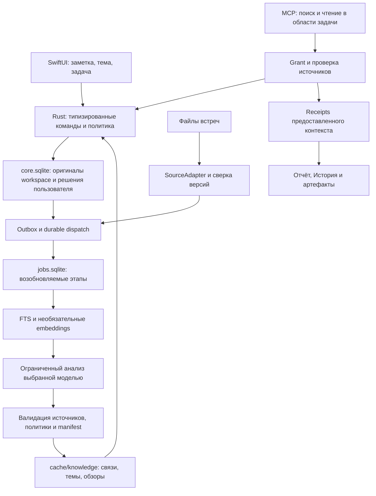

# Самоорганизующаяся база знаний After

Этот документ сохраняет исходный технический замысел от 30 октября 2026 года.
Он описывает и реализованные части, и дальнейшее развитие; его нельзя читать
как перечень уже доступных функций или как текущий release gate.

Актуальные решения имеют приоритет:

- [Исполнимый контракт продукта](knowledge-product-contract.md): ссылки на версии
  содержимого, совместимость старой библиотеки и явно одобренные снимки агента.
- [Состав и приёмка сборки](knowledge-release-plan.md): что подключено и чем проверено.
- [Снимки для агентов](agent-snapshots.md), [встроенный поиск](managed-semantic-search.md)
  и [смешанные темы](knowledge-mixed-topics.md): реальные маршруты и ограничения.

Публикация и установка поверх личной библиотеки остаются отдельным действием.

## 1. Результат для пользователя

Пользователь сохраняет заметки и встречи без предварительного проектирования папок,
тегов и зеттелькастена. After связывает материалы, поддерживает страницы тем и
помогает получить результат через агента. Пользователь может исправить организацию,
но не обязан регулярно разбирать очередь предложений ИИ.

Первый сквозной сценарий:

1. Добавить заметки и встречи об онбординге.
2. Открыть автоматически собранную тему: материалы, решения, вопросы, источники.
3. Создать задачу «Собери принятые решения и подготовь предложение» и разрешить
   агенту поиск в выбранной области.
4. Получить в Истории отчёт, артефакт и список предоставленных источников.
5. Перейти из результата к исходной заметке или реплике встречи.

Одна заметка может участвовать в нескольких темах. Автоматическая организация
не перемещает оригиналы между папками и не переписывает их текст.

Встроенный помощник также должен находить, объяснять и открывать материалы:
«что в последней задаче», «когда у меня встреча», «открой её», «что посоветуешь».
Его текущая основа, найденные пробелы и технический контракт выделены в
[сценарии помощника](assistant-workflows.md). Это самостоятельный native workflow;
он не требует task grant внешнего MCP-агента.

### Объём первой версии

| Входит | Отложено |
| --- | --- |
| Ручные связи заметок, обратные ссылки, закрепления и запреты | Автоматическое слияние, удаление и переписывание исходных заметок |
| Автоматические тематические связи с объяснением и источниками | Автоматическое объявление причинности, противоречия или истинности |
| Автоматические темы и обзоры с проверяемыми ссылками | Большая графическая карта и редактор онтологий |
| Заметки, опубликованные транскрипты и актуальные конспекты встреч | Постоянная индексация календаря, черновиков, произвольных папок и репозиториев |
| Поиск и чтение исходников через область доступа задачи | Внешний агент с неограниченным доступом к библиотеке |
| История работы и артефакты с происхождением | Автоматическое использование агентского пересказа как нового независимого доказательства |

Карточки, задачи, код и вложения сохраняют существующее поведение поиска. Их
включение в новую автоматическую организацию — отдельные SourceAdapter после V1.
Ответ обязан обозначать покрытие, если запрос касается неподдерживаемых материалов.
Чтение истории/артефактов по прямому вопросу native-помощника описано отдельно:
оно не включает такие результаты в автоматический граф доказательств.

## 2. Текущая основа и необходимые расширения

| Существующий код | Переиспользование и граница |
| --- | --- |
| [workspace_repository.rs](../../rust-core/src/workspace_repository.rs) | `core.sqlite`, CAS, receipts, outbox. Payload ограничен 32 MiB; нельзя складывать туда весь производный граф. |
| [notes.rs](../../rust-core/src/notes.rs) | UUID заметок, ревизии, папки, вложения. Устойчивых block ID и самостоятельной модели связей пока нет. |
| [knowledge.rs](../../rust-core/src/knowledge.rs) | Проверяемые источники, RRF, ответы с цитатами. Нужен обязательный ограниченный scope для агентского поиска. |
| [semantic.rs](../../rust-core/src/semantic.rs) | Manifest модели и chunker, поколения, проверка актуальности, локальные embeddings. Текущий лимит — 10 000 фрагментов. |
| [jobs.rs](../../rust-core/src/jobs.rs), [BackgroundJobs.swift](../../Sources/PosleApp/BackgroundJobs.swift) | Durable очередь и ограничения ресурсов. Нужны постоянная идемпотентность dispatch и низкий приоритет обслуживания. |
| [JobExecution.swift](../../Sources/PosleApp/JobExecution.swift) | Снимок профиля, отмена, проверка входов. Новые команды надо явно подключить к этим проверкам. |
| [task_workspace.rs](../../rust-core/src/task_workspace.rs), [mcp.rs](../../rust-core/src/mcp.rs) | Claims, contextVersion, отчёты, артефакты. Сейчас семь task-инструментов; поиска по библиотеке в MCP нет. |
| [TaskHistoryView.swift](../../Sources/PosleApp/TaskHistoryView.swift) | Расширить существующую Историю, без второго конкурирующего журнала задач. |

Три обязательных расширения инфраструктуры:

- Транскрипты и конспекты хранятся файлами вне транзакции workspace. Текущий outbox
  не является полным потоком всех изменений библиотеки.
- `jobs.sqlite` и `core.sqlite` — разные базы. Outbox и enqueue нельзя считать одной
  атомарной транзакцией. Текущий parent dedup не охватывает все завершённые задания.
- `commit()` возвращает старый snapshot при неизменном hash payload. Новые
  канонические KB-таблицы требуют расширения repository API, а не записи в обход него.

## 3. Архитектура



Rust владеет данными, выборкой, проверками, индексами и публикацией. Swift владеет
согласиями, планированием в жизненном цикле приложения, состояниями и интерфейсом.
LLM возвращает ограниченные данные, а не команды домена. Для V1 не нужны отдельный
Python daemon, Graphiti, Neo4j или сервер векторной базы.

### Инварианты

1. Удаление производного кеша не удаляет оригиналы, ручные связи, закрепления и запреты.
2. Изменение канонических данных, receipt, история и outbox фиксируются вместе.
3. Отмена или устаревший manifest не публикуют результат; поздний callback не возвращает удалённое.
4. Ни заголовок, ни цитата, ни тема, ни артефакт не расширяют область доступа агента.
5. Ссылка на существующую цитату подтверждает происхождение, но не доказывает истинность интерпретации.
6. Ручное решение имеет приоритет над переиндексацией и сменой модели.
7. Сохранение старого редактора или compatibility JSON не заменяет новые KB-таблицы.
8. Фоновые LLM-вызовы требуют собственного включения и не включаются вместе с обычным поиском.

## 4. Идентичность и источники

```text
SourceRef = { libraryID, kind, objectID, subID? }
SourceVersion = { ref, entityRevision?, contentFingerprint, policyRevision }
EvidenceAnchor = {
  ref, contentFingerprint, spanID, quoteHash,
  startUTF8?, endUTF8?, prefixHash?, suffixHash?
}
```

`libraryID` — локальный UUID библиотеки; `kind` — закрытый enum; `objectID` —
канонический UUID, а не имя, название темы или путь. Native-код формирует refs и
маршруты; модель выбирает только предложенные `spanID`.

У заметки пока нет block ID. Anchor привязан к версии и точному фрагменту UTF-8;
offset не используется без проверки hash. После правки допустим reanchor только
при однозначном совпадении цитаты и окружения. Иначе anchor получает `stale`.
Связь со всей заметкой может сохраняться, но устаревшая цитата не показывается как текущая.

Реплика встречи идентифицируется парой `meetingID + segmentID` вместе с
fingerprint транскрипта. Повторное распознавание не сохраняет идентичность
числового segment ID автоматически. Время служит для навигации после проверки версии.

Конспект — производный источник. Он допускается только с актуальной зависимостью
от транскрипта; legacy-конспект без такой зависимости не становится первоисточником
для автоматического подтверждения решения.

`SourceAdapter` предоставляет `enumerate(cursor)`, `snapshot(ref)`,
`validate(version)`, `extract_spans(snapshot)` и `policy(ref)`. Чтение использует
существующие ограничения файлов, symlink и блокировок. Новые адаптеры не обходят
внешние пути лишь потому, что они прикреплены к задаче.

## 5. Хранение и транзакции

### Канонические таблицы в core.sqlite

Канонические таблицы KB добавляются к существующей схеме `user_version=1` без
изменения старых таблиц: опубликованное ядро продолжает работать с ними. Это
пересмотр исходного плана `1 → 2` после проверки старой очереди и файловых
записей. Пробная schema 2 автоматически не открывается. Ниже — целевая
логическая схема; не все перечисленные таблицы реализованы.

| Таблица | Основные поля |
| --- | --- |
| `kb_state` | singleton, `revision`, `fingerprint`, `schema_version` |
| `kb_links` | UUID, from/to SourceRef, relation, origin, пользовательская причина, anchors, revision, timestamps, tombstone |
| `kb_feedback` | UUID, тип решения, endpoints/subject, payload, revision, timestamps |
| `kb_collections` | UUID закреплённой темы, имя, intent, seeds и versioned правило автоматического членства, pinned/excluded members, revision |
| `kb_policies` | scope UUID, выбранные источники/папки, автоматизация, ссылки на профиль, policyRevision; без секретов |
| `kb_operations` | operationID, requestHash, ограниченный before/after для Undo; durable receipt также в `operation_receipts` |
| `kb_events` | операция, actor, видимые изменения и время; без копирования полных исходников |
| Отдельное хранилище grant | область доступа задачи, run, epoch, срок, состояние; не помещать новые разрешения в legacy task materials |
| `kb_read_receipts` | append-only manifest сформированного агентского ответа, версия scope, refs/hashes/spans и время |

`kb_read_receipts` — аудит выдачи, а не изменение заметки: вставка не повышает
workspace/KB/task revision и не входит в contextVersion. Receipt не доказывает,
что внешний агент прочитал или понял текст. Разрыв транспорта может оставить
сформированный, но не подтверждённый клиентом ответ.

`kb_links` — единственный источник ручных и закреплённых связей. Backlinks
вычисляются обратным запросом. Копии той же связи в `CapturedNote.links` не вводятся.
Индексы обязательны для endpoints, коллекций, активных grants и зависимостей receipts.

### Расширение repository API

`apply_canonical_change(expectedWorkspaceRevision, expectedKBRevision?, entityRevisions,
operationID, requestHash, workspaceDelta, kbDelta)` выполняет под `notes::lock`
одну `BEGIN IMMEDIATE` в `core.sqlite`:

1. Проверяет revisions, полномочия и operationID. Идентичный повтор возвращает receipt;
   тот же ID с другим запросом — конфликт.
2. Применяет только затронутые записи. KB delta повышает общую workspace revision
   даже при прежнем notes payload; отдельно повышает `kb_state.revision`.
3. `workspace_state.fingerprint` остаётся hash notes payload. KB имеет собственный
   fingerprint; API возвращает оба и общую ревизию.
4. Сохраняет receipt, событие и один outbox event в той же транзакции.

Старые `persist_locked`/`compare_and_save` проходят через тот же gateway с пустым
KB delta и никогда не заменяют KB rows. Namespace receipts расширяется на `knowledge`.
Фоновые inferred links не меняют canonical rows и не создают постоянных конфликтов редактора.

`notes/workspace.json` остаётся прежним совместимым экспортом. Для KB предусмотрен
отдельный versioned `knowledge.json`; изменение JSON на диске не является API импорта.

Порядок блокировок един для новых и существующих mutators: `notes::lock` →
meeting locks по отсортированным IDs → короткая DB-транзакция. Внутри gateway
используются `_locked`/transaction-aware source helpers. Публичный
`knowledge::validate_source(root, …)` нельзя вызывать под уже взятым notes lock:
его note-путь повторно получает тот же lock. File adapter, удерживающий meeting
lock, сначала завершает файловый этап и отпускает его, затем входит в gateway.
Модельные запросы и полный reconcile выполняются вне этих блокировок.

### Производный кеш

`cache/knowledge/index.sqlite` хранит `generations`, `source_versions`, `spans`,
`suggested_edges`, `topics`, `topic_members`, `briefs`, `dependencies` и состояние
восстановимой обработки. Durable dispatch receipts, сведения о provider calls и
резервы бюджета находятся в `jobs.sqlite`, вне удаляемого кеша.
Оригинал заметки остаётся в canonical storage; excerpt — лишь
проверяемая копия с fingerprint и ограничением объёма.

Векторные данные переиспользуются из `semantic.rs`, без второго независимого
embedding manifest и скрытого повторного индексирования. Необязательный смысловой
поиск не включается автоматически; без него остаётся лексический подбор кандидатов.

Manifest поколения включает pipeline/extractor/chunker/prompt/schema versions,
модель, provider fingerprint, embedding manifest, scope policy revision и версии
входов. Держим одно active и максимум одно staging поколение. Публикация atomically
меняет active; старые поколения удаляются после завершения читателей.
Read path в любом случае повторно проверяет исходники: active не означает «вечно актуальный».

При инкрементальном обновлении staging содержит полный логический результат:
неизменные rows переносятся из active при прежнем row computation manifest и
актуальных собственных dependencies/политике; затронутая часть заменяется.
Row manifest содержит pipeline/model/config и входы конкретного результата.
Generation manifest дополнительно содержит состав всего поколения и может
измениться при правке другого документа, не запрещая copy-forward B–C.
Candidate-set digest относится к анализируемому batch и постановке новых работ;
он не делает происхождение прежнего B–C зависимым от всех чужих заметок.
Невалидные rows не копируются. Публикация одного соседства не удаляет остальные
связи и темы.

## 6. Связи и пользовательские решения

| relation | Основание | Как показывать |
| --- | --- | --- |
| `manual_link` | Явный выбор пользователя | Обычная ссылка и backlink |
| `source_of` | Проверенная доменная зависимость: реплика → конспект | «Источник» |
| `same_project` | Совпадение канонического project ID, не имени | «В том же проекте» |
| `related` | Подбор + ограниченный анализ ИИ | «Связано по смыслу», с причиной |

Свободное одинаковое название проекта не создаёт `same_project`. Выводы
`supports`, `contradicts`, `supersedes` не публикуются автоматически в V1.
Отсутствие записи о решении также не означает его отмену.

У inference edge есть `origin=ai`, freshness, manifest, обе стороны и evidence.
Самооценка LLM не показывается как процент достоверности. Проверка цитаты не
заменяет оценку полезности связи. Симметричные пары нормализуются сортировкой ID;
для направленных связей порядок сохраняется. Повтор не создаёт дубликат.

На заметке показываем до трёх автоматических связей, остальные по раскрытию.
Действия: открыть, закрепить, скрыть конкретную подсказку, «Не связывать эти материалы».
Запрет пары живёт по устойчивым IDs и переживает смену модели/ревизии. Скрытие
конкретной подсказки связано с её signature; это отличается от постоянного запрета.

Закрепление создаёт canonical link `origin=aiAccepted`; пересоздание кеша его
не удаляет. Принятие означает пользовательский выбор, а не доказанную истинность.

Ручная связь V1 создаётся через «Связать заметку» и выбор UUID. После этого
добавляется ввод `[[` с поиском и явным выбором целевой заметки в редакторе:
богатый текст хранит внутреннюю ссылку с UUID, а не только названием. Изменение
inline-ссылки и canonical link фиксируется одной командой. Одинаковые заголовки
не разрешаются автоматически. Работа с обычным текстом и RTF остаётся совместимой.

## 7. Темы и обзоры

Тема — представление над источниками. Папка и профиль не меняются. V1 допускает
несколько тем на документ и не заставляет пользователя выбирать категории заранее.

Начальный алгоритм `incremental-neighborhood-v1`:

1. Работать на уровне документов, схлопывая фрагменты одного оригинала. Для
   изменённого документа взять до восьми лучших взаимных соседей после валидации.
2. Сопоставить его с существующими темами по пересечению соседей и, при наличии,
   близости embedding к представителям темы. Допустить до трёх членств.
3. При отсутствии подходящей темы создать provisional neighborhood от четырёх
   разных документов. Изолированный материал остаётся доступным через поиск.
4. Сохранять identity темы при достаточно близком составе. Стартовая эвристика
   Jaccard ≥0,65; правила join/leave различаются, чтобы небольшие изменения не
   вызывали постоянных пересортировок. Пороги входят в versioned algorithm config.
5. Автоматическое объединение/разделение требует двух устойчивых пересчётов с
   интервалом не менее суток. Один этап обрабатывает до 200 документов затронутого
   соседства; остаток продолжается с cursor. Размер темы этим не ограничивается:
   membership хранится строками и читается страницами, обзор остаётся ограниченным.

Начальный контракт членства задаётся `algorithm config`, общий для всех workers:

```text
N(d) = до 8 проверенных взаимных соседей документа d
neighbor(d,t) = |N(d) ∩ members(t)| / max(1, min(8, |members(t)|))
semantic(d,t) = max(0, cosine(vector(d), centroid(representatives(t))))
lexical(d,t) = weightedJaccard(top20Terms(d), top20Terms(representatives(t)))
content(d,t) = semantic(d,t), если embedding manifest совпадает; иначе lexical(d,t)
membership_score(d,t) = 0.6 * content(d,t) + 0.4 * neighbor(d,t)
enter: score >= 0.72; leave: score < 0.55 в двух последовательных пересчётах
```

Термы нормализуются RU/EN stemmer и stop-list текущего FTS; веса считаются внутри
organizer scope. Представителей до восьми: явные seeds, затем наиболее связанные
разные документы; равенство разрешается по SourceRef. Ранги тем сортируются по
score, затем постоянному ID; документ получает максимум три автоматических членства.
Отсутствие embeddings использует полностью определённый lexical-путь, без скрытого
скачивания модели. Инвалидный/отозванный источник исключается сразу, без ожидания leave.

Provisional neighborhood публикуется от четырёх документов с плотностью проверенных
связей не ниже 0,5. Пробные группы создаются в порядке SourceRef, одинаковые составы
дедуплицируются. Первое появление темы не ждёт сутки; задержка относится к её
последующим слияниям/разделениям. Все коэффициенты — калибруемые defaults; при смене
config сохраняются ручные overrides и выполняется versioned пересчёт.

Параметры — стартовые для эксперимента, а не измеренное качество. Их выбор и
устойчивость проверяются на RU/EN-корпусе до включения автоматических тем по умолчанию.

Автоматический ID стабилен при обычном обновлении кеша, но не обещается после
полной перестройки. Закрепление/переименование создаёт `kb_collection` с постоянным
UUID, пользовательским названием и pinned/excluded members. Только canonical
коллекции получают постоянные ссылки. Автоматика не перезаписывает их ручные поля.

Закреплённая коллекция хранит также `intent`, seed SourceRefs и versioned правило
автоматического членства, а не только снимок текущего списка. Новый подходящий
материал добавляется по этому правилу; pinned members всегда включены, excluded
всегда исключены. Закрепление темы не закрепляет всех участников навечно.
После потери кеша правило применяется заново. Если все seeds удалены или правило
невыполнимо, показывается «Нужно уточнить тему»; коллекция не превращается молча
в обязательный ручной список.

Название выводится из представителей; при недоступной модели используются ключевые
слова. Содержание обзора: краткое описание, подтверждённые источниками решения,
открытые вопросы и хронология. Даты фактических решений берутся из источников,
а не из времени индексации. Каждый абзац имеет полный набор dependencies.
Нет достаточного основания — нет абзаца. Для V1 обзор ограничен 12 исходниками;
покрытие остальных обозначается явно и доступен полный список материалов.

Если одна зависимость устарела, смешанный обзор не отдаётся с простым удалением
ссылки: он пересоздаётся. Внешнему агенту V1 выдаются исходники, не общие обзоры тем,
которые могли учитывать закрытые материалы.

## 8. Инкрементальная обработка

### Обнаружение изменений

Consumer `knowledge-organizer-v1` получает workspace outbox. Для файлов встреч
нужен отдельный source-change adapter, подключённый к успешной публикации
транскрипта/конспекта, corrections, Trash и восстановлению. Watcher только
помечает необходимость проверки.

Запись файла и outbox разных хранилищ не объявляются атомарными. Существующие
журналы файловых операций восстанавливаются до сверки; затем bounded reconcile
сравнивает фактические fingerprints с каталогом. Он запускается на старте,
после recovery и порциями в простое. Пропущенное событие не должно навсегда
исключить материал. Read path блокирует устаревшие данные до завершения reconcile.

### Этапы одного обновления

1. Debounce изменений: две секунды после редактирования. Снимок снимается только
   после канонического сохранения; содержимое редакторского черновика не индексируется.
2. Rust получает SourceVersion и разрешённые spans, фиксирует policy/profile manifest.
3. Без LLM: top-20 FTS + top-20 vector, если включён, + до восьми явных соседей;
   дедупликация и RRF, максимум 40 кандидатов. Права фильтруются до ранжирования.
4. Удалить self-links, запрещённые пары, одинаковые первоисточники и уже проверенные
   пары с тем же manifest. В анализ передать до шести лучших пар.
5. Модель получает закрытую JSON-схему с `additionalProperties:false`, допустимыми
   IDs и spans. Ответ: до шести `related` связей с короткой причиной и spanIDs
   обеих сторон. Новые IDs, пути, команды и права не допускаются.
6. Rust извлекает цитаты сам, проверяет схему, принадлежность spans, размеры,
   endpoints и fingerprints. Одна ограниченная попытка исправить формат разрешена
   внутри общего бюджета. Невалидный ответ ничего не публикует.
7. Worker записывает staging. Перед публикацией повторно проверяет все зависимости,
   policy/provider manifest, profile и cancellation epoch. Конфликт отправляет
   новый снимок на обработку, не заменяя текущие canonical данные.
8. Публикуются связи и затронутые темы; обзор имеет отдельную версию и dependency set.

Final check и active-swap имеют общий короткий publish fence. По согласованному
порядку блокировок проверяются request/cancel/rebuild epochs, policy revision,
ожидаемый active и версии затронутых источников; затем в cache-транзакции
переключается active. Отмена и внутренние изменения источников/политики используют
тот же сериализованный протокол: публикация либо завершилась до изменения,
либо отклонена. Дополнительной DB-транзакции, атомарной сразу для двух баз,
здесь нет. Внешние файловые изменения и последующие правки закрывает read validation.

Входной manifest включает digest набора кандидатов: позднее появившаяся заметка
может дать новые связи при прежнем тексте исходной заметки. Новый/изменённый
источник проверяется в обе стороны; периодическая ограниченная сверка устраняет
устаревшие соседства без полного O(N²) прохода.

### Dispatch и повтор

Добавить `enqueueOnceKey` в jobs: durable unique receipt сохраняется и после
успеха/отмены и очистки короткой истории. Ключ включает library/scope, версии
источников, candidate digest и pipeline manifest. Ручной новый запуск получает
новый attempt ID; replay того же dispatch не повторяет оплаченный запрос.

Порядок: durable enqueue в `jobs.sqlite` → подтверждение outbox в `core.sqlite`.
Crash между ними повторяет enqueue с тем же ключом. Worker отдельно фиксирует
publish receipt в кеше; crash после publish, но до job-success возвращает готовый
результат того же manifest. Полная потеря кеша означает новую явную rebuild epoch,
которая позволяет заново выполнить локальные этапы, но не разрешает повторное
списание у провайдера.

Для каждого provider call вводится отдельный durable `model_invocations` ledger
в `jobs.sqlite`: logical invocation signature, billingAttemptID, reservation,
`prepared/started/succeeded/unknown`, usage и ограниченный result/ref. Signature
строится из точных входов, модели, профиля и prompt, без rebuild epoch. Запись
`started` фиксируется до отправки; crash после неё без подтверждённого результата
означает `unknown`. Решение о повторе не зависит от наличия cached publish receipt.

При восстановлении сначала переиспользуется сохранённый результат с повторной
валидацией. Если bytes потеряны, допустимо локальное восстановление или видимая
пауза. Повтор облачной генерации после `succeeded/unknown` требует явного нового
billingAttemptID и подтверждения пользователя. Автоматический recovery job не
обходит существующий `confirmPaid`. В ledger не сохраняются ключи и полный prompt;
очистка результатов сохраняет минимальные signature/usage tombstones.

## 9. Ресурсы, профили и согласия

`features.knowledgeBase` — новая необязательная возможность, отсутствующее поле
означает `false`. Её включение не включает tasks, assistant или semanticSearch.
История существующих задач продолжает работать независимо от неё.

Фоновая обработка имеет отдельную политику `knowledgeAutoOrganize`, по умолчанию
выключенную. Пользователь один раз выбирает область, профиль и локальную/облачную
обработку. Согласия для облачных embeddings, генерации и внешнего агента независимы.
Существующее ручное обращение к облачному помощнику не считается согласием на фоновые вызовы.

Для набора источников выбирается один явно заданный organizer profile. Запрос
разрешён только если каждый источник допускает этот provider/endpoint. Отказ одного
источника не компенсируется разрешением другого. Секреты получает native-код из
Keychain непосредственно перед исполнением; они не входят в job/config/cache/export.

| Ограничение | Стартовое значение, подлежит измерению |
| --- | --- |
| Тяжёлый фоновый старт | После 30 секунд простоя; нет записи/старта/остановки и другой приоритетной работы |
| Локальные модели | Один тяжёлый запрос; embeddings и генерация последовательно |
| Batch анализа | До шести пар; уменьшать до помещения в бюджет маршрута |
| Размер запроса | Полный prompt + schema ≤19 400 UTF-8 bytes, дополнительно ≤6000 input tokens |
| Выход | До 1000 tokens; ограниченный размер ответа и число структурных элементов |
| Таймаут | 60 секунд на provider call |
| Порция обслуживания | До 20 calls или пяти минут, затем yield |
| Память | Не начинать новую загрузку при pressure или оценке доступной памяти <3 GiB |
| Облачный стартовый бюджет после opt-in | 20 calls, 100 000 input / 15 000 output tokens в сутки; действует первый достигнутый предел |

Token budget считается tokenizer конкретного маршрута. Если его нет, применяется
консервативная byte-bound оценка и уменьшается batch; контекст модели проверяется
capability probe. Размер GGUF не принимается за оценку RAM. Ни один модельный
маршрут не объявляется поддержанным без проверки схемы, памяти и качества.

У jobs появляется `priority=user|maintenance` и admission по другим, более
приоритетным работам. Нельзя проверять внутри maintenance job `activeCount == 0`:
она будет ждать сама себя. Нет обещания мгновенного вытеснения уже исполняемого
чужого сервера; foreground блокирует следующий batch, отмена закрывает публикацию
сразу. Приложение не завершает общий Ollama/LM Studio процесс целиком.

Нужен общий `ModelExecutionLease` для всех инициированных After модельных вызовов,
включая отдельный SemanticIndexController, query embeddings, probes, repair и
генерацию обзоров. Job получает lease при claim и передаёт его вложенному вызову
без повторного захвата; прямой foreground-вызов получает временный lease.
Одна priority-колонка в jobs не координирует вызовы вне очереди. После cancel
lease остаётся занятым до завершения/остановки собственного запроса, чтобы новый
batch не наложился на ещё работающий старый.

Если timeout/отмена клиента не подтверждает завершение на сервере, lease получает
`draining/unknown`. Такой маршрут не считается свободным автоматически: сначала
подтверждение завершения, проверка состояния backend или явное восстановление.
Запись не блокируется этим ожиданием; приостанавливаются следующие модельные calls.

Последовательные HTTP-вызовы не гарантируют выгрузку моделей из памяти общего
сервера. Для собственного runtime проверяется резидентность/освобождение модели;
для общего Ollama/LM Studio отсутствие допустимого memory budget означает паузу,
а не принудительную выгрузку чужой модели.

В `ai.rs` требуется новый `generate_bounded(GenerationLimits, cancellation, lease)`:
передаваемые input/output/timeout/response-size limits, usage и invocation ledger.
Текущий `generate()` использует 6500 output tokens и 600 секунд, поэтому не
обеспечивает лимиты таблицы. Новый API ограничивает ответ 64 KiB; byte budget
включает system, сериализованный prompt, schema/enums и spans. Token count учитывает
chat framing и резерв выхода. Для проверенного byte-level tokenizer допустим
консервативный bound `UTF8 bytes + framingTokens`; неизвестный tokenizer/template
без проверенного bound означает неподдерживаемый маршрут. Client abort не
объявляется гарантией расхода провайдера при отсутствии server-side cap.
Repair, overview и probe проходят через те же лимиты и бюджет. Совместимые старые
вызовы сохраняются; новые KB jobs не используют их старые defaults.

Облачный бюджет резервируется до запроса и сверяется по usage. При неопределённом
результате списывается резерв; paid retry только явно. Дневной счётчик ограничивает
расход внутри After, но не является гарантией счёта провайдера. Скрытого перехода
в облако при ошибке локальной модели нет.

Счётчик — общий для автоматизации одной библиотеки, сутки по UTC. Смена модели,
endpoint, профиля или rebuild не обнуляет резерв/usage. Все repair/probe/overview
calls учитываются. Состояние дневного лимита и неизвестных попыток сохраняется
в durable ledger при перезапуске и очистке кеша.

## 10. Предлагаемые команды домена

Все новые имена ниже — проект. Существующие `knowledge-search` и
`knowledge-validate-source` сохраняются; расширение не открывает их без scope в MCP.

| Native-команда | Назначение |
| --- | --- |
| `knowledge-neighbors` | Ручные и актуальные автоматические связи с pagination и coverage |
| `knowledge-topic-list`, `knowledge-topic-read` | Темы и проверенный обзор/список источников |
| `knowledge-link-put`, `knowledge-link-remove` | Canonical связи, expected revisions, operationID |
| `knowledge-feedback-put` | Скрытие подсказки, запрет пары, исправление |
| `knowledge-collection-put` | Закрепление темы/членства и изменение ручного названия |
| `knowledge-operation-undo` | Компенсация по затронутым after-state/revisions |
| `knowledge-policy-put` | Область, режим, профиль; повышение policy revision |
| `knowledge-grant-put`, `knowledge-grant-revoke` | Task-bound разрешение агенту; только native-сторона |
| `knowledge-reconcile`, `knowledge-maintain` | Возобновляемые bounded worker stages |

Read API возвращает `schemaVersion`, `generation`, `coverage`, `warnings`,
`truncated`, `nextCursor`. Cursor связан с manifest и scope; устаревший cursor
не продолжает выдачу из прежнего разрешения. Ошибки имеют фиксированные коды:
`conflict`, `stale_source`, `scope_revoked`, `budget_exhausted`, `model_unavailable`,
`unsupported_schema`. Скрытые ID и тексты не включаются в ошибки.

## 11. Поиск для внешнего агента

### Grant и граница доступа

Два новых инструмента сохраняют технический префикс `posle_` ради совместимости:
`posle_task_knowledge_search` и `posle_task_knowledge_read`. Они требуют активный
claim задачи и native-created grant, связанный с серверной сессией/run.

```json
{
  "grantID": "opaque-id",
  "taskID": "manual:task-id",
  "libraryID": "library-uuid",
  "runID": "server-assigned-run",
  "epoch": 3,
  "permissions": ["search", "read"],
  "scope": {
    "sources": [
      {"kind": "note", "objectID": "note-id"},
      {"kind": "meeting", "objectID": "meeting-id"}
    ],
    "includeFutureObjects": false
  },
  "expiresAt": 1793400000
}
```

Пользователь может выбрать папку/тему целиком; native-код разворачивает выбор в
manifest текущих IDs и показывает состав. В V1 будущие объекты автоматически не
добавляются. Изменение grant повышает epoch; старые claims/cursors не оживают
при повторном включении. Срок ограничен запуском и явным сроком grant.

`agentID` — отображаемое имя, не authentication principal. Scope не берётся из
аргументов модели. Сессия сопоставляется с grant доверенным native broker/adapter
через opaque capability; секрет не попадает в prompt, tool results и логи.
Обычная legacy stdio-сессия без такого связывания сохраняет семь прежних tools
и не получает KB search. Глобальный `knowledge-search` остаётся native-only.

KB-enabled claim хранит серверные principal/run/grant epoch. Все его изменения —
в том числе старые progress/report/complete/release и их replay — проверяют это
связывание и обязательную evidence-политику. Знание claimID и подстановка agentID
не позволяют legacy-сессии использовать чужой claim или сдать отчёт в обход
нового контракта. Совместимость старых инструментов относится к их собственным
legacy claims, а не к обходу более строгого KB-enabled запуска.

Это ограничение возможностей API. Оно не является sandbox от произвольного
процесса того же macOS-пользователя с прямым файловым доступом к библиотеке.

### Поиск и чтение

```json
{
  "tool": "posle_task_knowledge_search",
  "arguments": {
    "taskID": "manual:task-id",
    "claimID": "claim-id",
    "expectedContextVersion": "current-task-context",
    "query": "почему изменили критерий успешного онбординга",
    "limit": 10
  }
}
```

Сервер возвращает `receiptID`, `grantEpoch`, `scopeVersion`, opaque `sourceID`,
fingerprint, тип, заголовок, bounded excerpt и coverage. Limit: default 10,
maximum 20; query ≤2000 UTF-8 bytes; результат search/read ≤24 KiB. Transcript
read возвращает точные разрешённые реплики, не всю запись и соседние материалы.

`posle_task_knowledge_read` принимает taskID, claimID, sourceID и
expectedSourceFingerprint. Opaque sourceID действует только в выдавшем run и scope.
Перед ответом проверяются grant/epoch, источник и версия. Передача `root`, path,
`includePrivate` или собственного списка разрешённых ID в tool запрещена схемой.

Для внешнего поиска требуется отдельный scoped retrieval entry point. Фильтрация
FTS, vectors и доменных выборок выполняется до ranking/limit; нельзя вызвать
нынешний whole-library `lookup` и удалить несколько результатов после него.
Закрытые записи не влияют на видимые названия тем, counts, ошибки и backlinks.
Ранги RRF вычисляются внутри разрешённой области. Общие BM25 corpus statistics
могут зависеть от закрытых документов; для нового API требуется scope-local
лексический scoring/index либо доказанная эквивалентная выборка. Проверка:
добавление/изменение только закрытых записей не меняет видимую выдачу и порядок.
V1 не передаёт агенту общие AI-обзоры тем и не выполняет дополнительный LLM-вызов
при search/read. Query embeddings используют только разрешённый маршрут;
иначе остаётся FTS. Это предотвращает скрытую облачную обработку поискового текста.

### Receipts и завершение

Receipt фиксирует refs/fingerprints/spans именно сформированного ответа, run,
grant epoch, claim, query hash и режим retrieval. Полные тексты в audit rows не
дублируются. Чтение не меняет task revision и не порождает конфликт само с собой.

Отчёт расширяется `evidenceReceiptIDs` и ссылками на источник/фрагмент. Сервер
проверяет принадлежность receipts текущему run и задаче. `evidenceVersion` — hash
использованных версий, grant epoch и task context. Он не включает сами receipts,
текст отчёта или его derived evidence поля. Порядок report в одной транзакции:
проверить входной context/CAS и sources → сохранить отчёт и повысить task revision
→ вычислить post-report context → сохранить его и evidenceVersion в report event.
Complete сравнивает текущий контекст с этим post-report snapshot и проверяет
sources до собственного повышения revision. Отчёт не инвалидирует сам себя.
Изменение неиспользованной заметки не должно инвалидировать весь запуск;
изменение использованной требует нового чтения и отчёта.

Отзыв grant блокирует следующие выдачи и replay старого ответа. Идемпотентный
receipt не обходит новую проверку доступа. Уже переданные внешнему клиенту или
провайдеру байты отозвать невозможно.

## 12. История и артефакты

Существующие progress/report/complete сохраняются. История показывает понятные
события: запуск, предоставленные материалы, отчёт, артефакт, применение ручного
решения. Технические batches/chunks остаются в diagnostics, без засорения Истории.
UI не называет предоставленный контекст «проверенным агентом».

У нового артефакта есть `origin`, task/run/claim, `contentRevision`, cited evidence
и полный `disclosureDependencies`. Последний набор вычисляет сервер из всех
материалов, предоставленных запуску, включая контекст claim. Нельзя доверять
только списку зависимостей, добровольно названному моделью: она может пропустить
источник, но пересказать его содержимое.

Повторная агентская выдача артефакта допускается только при доступности всех
disclosure dependencies. Та же проверка охватывает свободный текст отчёта,
исторические snapshots и idempotent replay; текущий sanitizer `agent_result`
нужно расширить до появления KB tools.

В V1 агентские артефакты доступны через Историю и исключены из автоматического
поиска доказательств. «Добавить в базу» — явное действие пользователя: создаётся
производная заметка со ссылкой на результат и происхождением. Её принятие не
превращает пересказ в независимое подтверждение исходника. Расширение retrieval
на такие заметки требует root-source dedup и защиты от циклического самоподтверждения.

## 13. Удаление, устаревание и отмена

Каждое ребро и абзац обзора имеет полный dependency manifest; обратный индекс
позволяет найти зависимые результаты. Изменение или отзыв делает их недоступными
на read path немедленно, даже если фоновая физическая очистка ещё не прошла.

| Событие | Поведение |
| --- | --- |
| Rename/move | UUID сохраняется; обновляются название, policy и зависимые представления |
| Правка | Проверить anchor; invalid/stale результаты исключить, очередь пересчитывает затронутое |
| Trash | Источник и производные цитаты исключаются; canonical links сохраняют недоступный endpoint |
| Restore того же UUID | Перепроверить версии и разрешения; старый кеш не включается без проверки |
| Hard delete | Удалить управляемые кеш-копии, spans и vectors; сохранить минимальные IDs/hashes для tombstones |
| Отзыв scope/cloud | Закрыть следующие запросы и публикацию; отфильтровать зависимые результаты |
| Выключение возможности | Остановить автоматизацию; canonical данные и существующая история задач остаются |

Исторический пользовательский отчёт — самостоятельный сохранённый результат.
Удаление источника не обещает стереть все ранее созданные пересказы и внешние
экспорты. В родном интерфейсе исторический результат отмечается как таковой;
повторная выдача агенту проверяет зависимости. Удаление производных сохранённых
результатов требует отдельного явного действия, без молчаливого стирания истории.

Для управляемых дословных копий источника политика строже: hard delete очищает
тексты/цитаты/названия удалённого источника из claim/report context snapshots,
job inputs и сохраняемых provider results, оставляя IDs/hashes и явную отметку
redaction. Это не регенерация исторического снимка; очистка записывается отдельным
событием. Legacy snapshots с noteID/meetingID/materialID включаются в этот обход.
Бесструктурный пользовательский текст отчёта или экспорт — отдельный результат,
для которого не обещается автоматическое обнаружение всех пересказов.

Undo — компенсирующая операция по затронутым записям, с проверкой after-state и
ревизий. При последующих изменениях возвращается конфликт. Полный старый snapshot
библиотеки не восстанавливается поверх независимых правок. Модельный ответ не
может выполнять Undo, merge или filesystem-команды самостоятельно.

## 14. Миграция, восстановление и перенос

1. До migration: штатный SQLite backup API с WAL, проверка целостности и payload hash.
   Копирование только открытого `core.sqlite` через `cp` не является корректным backup.
2. В одной транзакции создать пустые KB tables/indexes и state, сохранив
   `user_version=1`, notes UUID/revisions/payload, receipts и outbox deliveries.
3. Не запускать индексацию, не создавать связи и не включать облако в migration.
4. После commit использовать обычный opt-in. Cache rebuild работает отдельно от migration.
5. Старый бинарник может работать со старым форматом, но не знает новых grant.
   Новые scoped permissions не должны попадать в старый механизм доступа.
   Возврат к старой версии и работа настоящего старого worker требуют отдельных
   испытаний; feature-off не удаляет новые таблицы или пользовательские решения.

Потерянная canonical DB после marker не восстанавливается из старого JSON.
Повреждённый derived cache изолируется и перестраивается с новым rebuild epoch;
ручные решения не восстанавливаются из AI-ответов.

KB export содержит versioned manifest, library/UUID mapping, ручные/закреплённые
связи, anchors, feedback и canonical collections. Original notes экспортируются
совместимо с текущим форматом. Кеш — необязательный generated-раздел. Grants,
capabilities, ключи, claims, jobs и audit receipts не переносятся как полномочия.
Import требует staging, проверки формата и явного remapping при коллизиях IDs.
Универсальный перенос всей библиотеки между устройствами остаётся отдельным проектом.

## 15. Интерфейс

- На заметке: «Связи» с ручными backlinks и максимум тремя автоматическими соседями;
  причина, источник, открыть/закрепить/не связывать. Без обязательного inbox предложений.
- В разделе «База знаний»: автоматически собранные темы, закреплённые подборки,
  поиск, индикатор покрытия и состояния обработки. Список исходников остаётся доступен.
- На странице темы: описание, решения, вопросы, материалы; каждый вывод открывает
  основание. Состояния: готово, обновляется, недостаточно данных, модель недоступна,
  пауза, бюджет исчерпан. Частичная база не изображается полностью обработанной.
- В задаче: выбор области доступа и «Что увидит агент», затем текущая История
  с результатом, артефактом и источниками.
- В помощнике: найти/ответить/посоветовать → уточнить → открыть точный объект,
  событие или артефакт. Typed recency и время не заменяются semantic top-1;
  подробная приёмка — в [отдельном workflow](assistant-workflows.md).
- В настройках: локальная/облачная автоматизация, область, профиль, лимиты,
  остановка и перестройка. Выбор не требует проектирования типов знаний.

Существующие `Ink`, `AppTypography`, `AppTabBar`, sheets и навигация источников
переиспользуются. Выбор темы не загружает всю библиотеку на main thread. Async
ответы привязаны к presentation/request generation, как у окна источников.
Все новые строки покрываются RU/EN; активация скрытого раздела не включает функцию.

## 16. План реализации и границы PR

| Этап | Изменения | Условие завершения |
| --- | --- | --- |
| 1. Каноническая основа | `knowledge_repository.rs`, core migration/gateway, SourceRef/Anchor модели; manual links/backlinks, feedback, Undo | Crash/CAS/replay/migration tests, удаление кеша сохраняет ручные данные |
| 2. Обновляемые источники | SourceAdapter, файловая reconciliation, durable enqueueOnceKey/invocation ledger, общий ModelExecutionLease и priority | Пропущенные события и crash между двумя DB не теряют обновления и не повторяют завершённый paid call |
| 3. Автоматическая организация | Bounded provider API, candidates/validator, staged edges, neighborhood topics, обзоры, opt-in и budgets | Один сквозной RU/EN-сценарий; quality/resource gates ниже |
| 4. Работа агента | Broker/session grant, scoped search/read, receipts, evidenceVersion, provenance sanitizer; История | Выбранная база → отчёт → артефакт → источник; отзыв закрывает все API-пути |
| 5. Доведение UX | Inline links, закреплённые темы, восстановление/экспорт KB, states, accessibility, visual docs | Native flow, непрерывные правки/удаления/перезапуск, демонстрация настоящих экранов |

Сценарии native-помощника идут отдельной дорожкой J1–J3 из
[дополнения](assistant-workflows.md#10-план-доработки-и-приёмка): typed find/open,
«последняя задача», календарные вопросы и история могут дорабатываться до
автоматических тем. Они не ждут внешнего MCP broker и не наследуют его grants.

Предлагаемые новые модули: `knowledge_sources.rs`, `knowledge_repository.rs`,
`knowledge_graph.rs`, `knowledge_organizer.rs`, `knowledge_access.rs`,
`KnowledgeOrganizationModels.swift`, `KnowledgeOrganizationController.swift`,
`KnowledgeLibraryView.swift`, `KnowledgeRelationsView.swift`.
Это границы ответственности; названия могут уточняться при первом PR без смены контрактов.

Изменения `workspace_repository`, `jobs`, `knowledge`, `semantic`, `task_workspace`,
`mcp`, feature/profile models и migrations обязательны — отдельного Swift-only
слоя поверх старого поиска недостаточно. Существующие функции и семь MCP tools
сохраняют совместимость, без автоматического расширения прав старых клиентов.

Ни один этап не назначен на текущий микрорелиз. Разработка функции и публикация
новой версии требуют отдельного решения после проверки сквозного сценария.

## 17. Проверки и критерии готовности

Числа ниже — предлагаемые gates для измерения, не достигнутые характеристики.

### Корректность и доступ

Обязательные синтетические сценарии:

- Падение до/после migration commit, canonical delta, enqueue, ack, publish и job-success.
- Идентичный replay, operationID с другим payload, terminal job dedup, очистка кеша/rebuild epoch.
- Правка документа A сохраняет актуальные незатронутые связи/темы B–C при смене
  generation digest; появление нового кандидата ставит нужный batch, не стирая весь кеш.
- Параллельное сохранение заметки, ручной связи, запрета, темы; Undo после чужих правок.
- Rename/move, повторный ASR с теми же segment numbers, неоднозначная цитата,
  Trash/restore/hard delete и поздний ответ модели.
- Hard delete очищает дословные копии в новых и legacy claim/report snapshots,
  job inputs и provider results, сохраняя минимальные redaction receipts.
- Crash между request-started/send/receive/response-store/publish; cache rebuild
  и смена профиля не сбрасывают paid-attempt ledger и дневной бюджет.
- Полный перебор grant revoke между search/read/report/complete; повторное включение,
  старые cursors, receipts другого run/task, подмена agentID и попытка передать root.
- Закрытый источник не раскрывается через title/snippet, сортировку/count, тему,
  старый отчёт, свободный текст artifact, snapshot или replay.
- Prompt injection, неизвестные IDs/spans, malformed/oversized JSON, Unicode RU/EN,
  symlink/traversal и отсутствие доступа к файлам по одной ссылке на папку.
- Нет облачного вызова без отдельного согласия, после смены endpoint, отмены,
  исчерпания бюджета или отзыва policy. Тесты используют только localhost fixtures.
- Старые notes/task/MCP/search/corrections/trash contracts остаются зелёными.
- KB-enabled claim не используется через legacy-сессию, даже с известными claimID/agentID.
- Report → complete проходит без self-conflict; реальные изменения used source
  вызывают конфликт, read receipts и неиспользованные заметки — нет.
- Pin темы → подходящая новая заметка добавляется, нерелевантная не добавляется;
  полная перестройка сохраняет UUID, имя, автоматическое правило и overrides.
- Одновременные semantic refresh, KB maintenance и foreground search/recording
  соблюдают общий admission; вложенный вызов job не захватывает lease повторно.

Для этих fixtures допускается ноль публикаций устаревшего/отозванного содержимого
и ноль невидимых повторных оплаченных операций. Это проверяемые инварианты стенда,
не утверждение о формально доказанной безопасности всей системы.

### Полезность и производительность

Подготовить отдельный размеченный RU/EN/mixed корпус: минимум 300 пар и 100
пользовательских вопросов, включая одноимённых людей, разные проекты и меняющиеся
решения. Разделить calibration и holdout; сравнить текущий FTS+vector baseline с
новыми связями/темами, зафиксировать модели, manifest и параметры.

- Полезность показанных top-3 `related` связей: целевой precision ≥85% по оценке
  владельца материалов; отдельно измерить пропуски, шум и покрытие.
- Цитаты обязаны указывать на точные spans в 100% fixtures. Это не заменяет
  ручную проверку смыслового основания связи и абзацев обзора.
- Измерять churn тем на последовательности правок; ручные имена/закрепления
  должны сохраняться всегда, ненужные переименования — отдельная метрика.
- На целевом Apple Silicon 16 GiB: p95 main-thread stall ≤100 ms, кешированные
  связи ≤200 ms; отдельно p95 поиска, time/100 документов, peak footprint,
  swap/pressure, tokens/document и расход энергии.
- Действующий cap 10 000 embedding fragments не повышается молча. Сверх лимита
  сохраняется FTS и показывается неполное покрытие. Расширение — после отдельного
  измерения памяти/скорости и проверки отсутствия голодания старых материалов.
- Запись и пользовательская обработка не ждут следующего maintenance batch;
  нет одновременной загрузки тяжёлой embedding-модели и генерации по ошибке scheduler.

После технических gates — пилот 2–4 недели с несколькими сценариями работы.
Цель эксперимента: на 30% меньше времени на повторный поиск и организацию при
неухудшившемся качестве результата. Считать также ручные исправления и отключения
автоматики. Количество созданных связей само по себе не является успехом.

## 18. Решения для первого прототипа

Принято для начала: SQLite, Rust domain, пересоздаваемая организация, оригиналы
и ручные решения в canonical storage, scoped read-only MCP, существующая История.
Большой графовый движок и автоматические разрушительные изменения не требуются.

До выхода из прототипа надо подтвердить измерением:

- Надёжный structured-output маршрут на целевом Mac; Qwen3.5 9B или другая
  доступная модель не считается подходящей только по названию/размеру файла.
- Пороги соседств и стабильности тем на русском, английском и смешанных заметках.
- Пользу обзоров и связей относительно существующего гибридного поиска.
- Стоимость source validation и нового repository gateway при 10 000 заметок.

Если gate модели или качества не выполнен, оставляем ручные связи и поиск,
а автоматические темы остаются experimental; удалённый fallback не включается.

## Источники проектных решений

- [Архитектура текущего After](../architecture.md) — источник истины, профили, поиск, ссылки и разрешения.
- [Microsoft GraphRAG Query Engine](https://microsoft.github.io/graphrag/query/overview/) — разные retrieval-режимы; global search ресурсоёмок и требует сравнения с baseline.
- [HippoRAG 2](https://arxiv.org/html/2502.14802v2) — исследование multi-document retrieval; его результаты не являются проверкой нашей локальной модели или организационной нагрузки пользователя.
- [Graphiti](https://github.com/getzep/graphiti) — инкрементальные графы и требования к structured output; библиотека не выбрана зависимостью After.
- [DFKI о самоорганизующихся помощниках](https://arxiv.org/html/2308.01732v1) — контекст работы, изменение организации и необходимость длительной пользовательской оценки.
