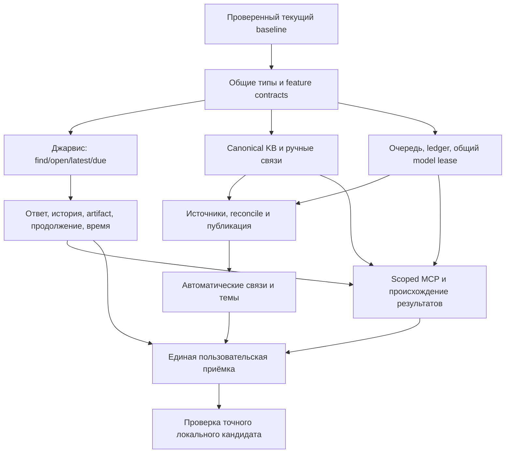

# Интеграция базы знаний и помощника в версию After

Дата: 30 октября 2026 года. Статус: план разработки и проверки.
Предлагаемая цель — **After 0.18.0**, сначала локальные тестовые сборки.
Текущие `0.17.6.5 / build 34` в packaging не меняются этим документом.
Публикация кода, GitHub release и продвижение Sparkle feed не выполняются.

План объединяет [базу знаний](knowledge-base.md) и
[сценарии Джарвиса](assistant-workflows.md) в один работающий путь:

> Сохранить материалы → получить связи и тему → задать вопрос → открыть источник
> → поручить агенту работу в выбранной области → получить отчёт и артефакт в Истории.

## 1. Состав первой тестовой версии

| Пользователь видит | Условие готовности |
| --- | --- |
| «База знаний» в текущей навигации | Область, поиск, темы, закреплённые подборки и понятное неполное покрытие |
| Связи внутри заметки | Ручная ссылка, backlink, до трёх автоматических соседей, основание, закрепление и запрет |
| Текущий помощник с новыми сценариями | Найти/ответить/посоветовать/открыть; «последняя задача», «на сегодня», «открой её» без случайной навигации |
| Страница темы | Обзор, материалы, решения и вопросы; каждый вывод открывает источник |
| Материалы задачи и существующая История | Выбор области агенту, «Что увидит агент», отчёт, артефакт и предоставленные источники |
| Новые scoped MCP search/read | Только broker-bound grant; legacy-клиенты не получают дополнительные права |

Первая автоматическая организация поддерживает заметки, опубликованные транскрипты
и актуальные конспекты. История задач читается помощником по запросу. Карточки,
код, календарь и агентские пересказы не включаются молча в общий граф доказательств.

Редактор графа, конструктор онтологий, автоматическое переписывание/слияние оригиналов
и синхронизация устройств остаются за рамками версии. Inline `[[` можно перенести,
если rich-text round-trip ещё не готов; native picker и backlinks обязательны.
Ограничивать сначала число поддержанных модельных маршрутов и размер области,
сохраняя законченный пользовательский сценарий.

## 2. Что необходимо закрыть до новой функциональности

В текущем рабочем дереве смешаны исправления записи, аудио, Sources, календаря,
Корзины, импорта, бренд After, окно изменений и упаковка. Для них нужен отдельный
проверяемый baseline B0, а не предположение, что наличие кода означает готовность.

Открытые проверки B0:

- Воспроизвести и разобрать последний провал `--check-release-notes`: повторное
  открытие после настроек не находило `releases.close`. Установить, проблема ли
  в UI или в драйвере, и получить PASS на текущем исходном снимке.
- Проверить изменения guidance после последней сборки, включая старую пустую
  библиотеку и персонализацию без выдачи включённой функции за использованную.
- Подтвердить запись/сохранение/воспроизведение, PCM timeline, отмену запуска,
  повторное открытие Sources и stale navigation на текущем коде.
- Проверить After в RU/EN, callback входа, About, меню, helpers и будущей упаковке.
- Подтвердить совместимость старых адресов обновления; реальный сценарий Sparkle
  `После.app → After.app` ещё требуется добавить к существующему SDK-стенду.

67 Rust-тестов существующего knowledge/voice кода прошли 30 октября. Это полезный
baseline, но они не проверяют новые темы, grants, ReadPlan и чтение артефактов.
Их прежний отчёт не привязан к полному digest будущего release candidate.

После B0 зафиксировать локальную исходную точку и результаты. Не делать reset,
не терять untracked исходники и не переносить изменения между копиями через
неполный diff. Публичный микрорелиз для этого не требуется.

## 3. Очерёдность интеграции

| Срез | Конкретная поставка | Проверка перед объединением |
| --- | --- | --- |
| F0 | SourceRef/Version/Anchor, AssistantReadPlan, request clock/scope; Swift/Rust flags и профили | Serialization, неизвестные enums, старые settings, отключённые модули |
| J1 | Детерминированный вход поиска, find/open, created/report/due selectors до caps | Новая задача против старой с новым progress; поиск без модели; открытие без изменения |
| J2 | History/artifact adapter и routes, conversation targets, advice, async calendar snapshot | Ответ → «открой её» → точный объект; факт/совет; полночь/DST; несохранённый редактор |
| K1 | Core schema v2, canonical gateway, ручные links/backlinks, feedback, collections, Undo | CAS/replay/crash, совместимость старого редактора, cache deletion, backup |
| Q1 | Jobs migration, future-version guard, enqueue-once, invocation/budget ledger, общий ModelExecutionLease | Cancel/timeout/unknown, crash около provider call, отсутствие повторного списания и двойного admission |
| S1 | SourceAdapters, файловый recovery/reconcile, copy-forward и publish fence | Пропущенное событие, правка A без потери B–C, stale/Trash/revoke после долгого анализа |
| K2 | Bounded model API, related links, neighborhood topics, динамическое закрепление и обзор | RU/EN corpus, источники, устойчивость тем, сохранность оригиналов и overrides |
| M1 | Broker principal/run, task grant, search/read receipts, report/evidenceVersion и sanitizer | Полный MCP lifecycle; legacy bypass, отзыв, replay и зависимости artifact |
| E0 | Настоящие экраны и пять сценариев ниже, настройки/состояния/локализация | Native driver проходит каждый сценарий с реальными domain responses |
| R0 | Clean candidate, release bundle, PKG/ZIP, upgrade и аппаратная приёмка | Точные hashes и все обязательные gates; публикация остаётся отдельным действием |

J1/J2 можно внедрять раньше автоматических тем. M1 не обязан ждать кластеризацию:
он сначала работает по выбранным исходникам. UI разрабатывается по общим типам
параллельно, но test-only заглушки не считаются завершённой функцией.

В общих файлах `knowledge.rs`, `task_workspace.rs`, `AppStore`, `PosleApp`,
feature models и repository/job gateways изменения объединяются последовательно.
У каждого среза один владелец соответствующего контракта; при конфликте сначала
согласуется контракт, затем UI/CLI, без нескольких несовместимых моделей данных.

## 4. Миграция и обратная совместимость

Core сейчас имеет schema v1; планируется v2. Jobs имеет v2; расширение ledger,
lease и dispatch требует отдельной migration, предварительная цель — v3.
Номера фиксируются при реализации migration, не при создании этого плана.

Startup preflight новой версии проверяет все поддерживаемые schema до запуска
очереди, recovery, модельных запросов и инициализации изменяющих хранилища служб.
Core и jobs — разные DB: их обновление не является общей SQL-транзакцией.
Нужен durable migration journal с идемпотентными шагами и проверкой фактических
версий после crash. Частично завершённое обновление блокирует обычную работу до
recovery; оно не запускает старый worker над новой схемой.

Перед migration остановить исполнителей и получить согласованный SQLite backup
обеих баз с учётом WAL. Проверять UUID, revisions, media/source hashes, receipts,
claims и paid unknown states. Migration не включает AI и не выдаёт новых прав.

Особый gate: у старого `jobs::open()` нет отказа на future schema. Добавление
guard в новый код не исправляет уже выпущенный бинарник. На disposable fixture
надо проверить старые поддерживаемые приложения после migration: они должны
безопасно отказать, не менять новую очередь и не запускать provider call.
Если это не выполняется, до RC требуется совместимая схема/изоляция нового
хранилища или пересмотр протокола обновления. Одного feature flag недостаточно.

Отключение KB не откатывает schema. Поддержанный возврат к старой версии требует
отдельной процедуры восстановления с сохранением новых изменений; автоматическая
подмена DB старым JSON или backup запрещена.

## 5. Флаги и первый запуск

В интерфейсе — «База знаний · экспериментальная». Внутри — eligibility тестовой
сборки, сохранённый `features.knowledgeBase=false` и отдельный
`knowledgeAutoOrganize=false`. Не показывать набор технических экспериментов.

Никаких скрытых загрузок модели, cloud fallback, фоновой индексации при migration
или расширения старого MCP grant. Пользователь выбирает область и модельный
маршрут. Cloud embeddings, фоновая генерация и внешний агент имеют разные согласия.

| Комбинация | Обязательное поведение |
| --- | --- |
| KB off, assistant on | Существующий помощник работает по разрешённым исходникам; нет auto topics и новых KB grants |
| KB on, assistant off | Ручные связи/темы доступны по настройкам; assistant не включается |
| Tasks off | KB заметок/встреч работает; task history и MCP недоступны |
| Calendar off или permission denied | Нет скрытого подключения; due задачи не выдаётся за календарное событие |
| SemanticSearch off | Structured/FTS и навигация работают; embedding вызовов нет |
| Auto-organize off | Ручные решения сохраняются; новых maintenance calls нет |
| Модель отсутствует/unsupported | Ручные связи и точный поиск работают; synthesis имеет понятное состояние |
| Cloud consent off | Вопрос, классификационный контекст и исходники не уходят в облако |
| MCP off/grant revoked | Native KB остаётся; новые агентские чтения и старый replay закрыты |

Также проверить global/folder overrides: on в папке A и off в B, перемещение
источника между ними, смена профиля во время запроса. Eligibility определяется
профилем конкретного источника и действием, а не только текущей вкладкой.

## 6. Пять обязательных сквозных сценариев

**G1. Материалы → тема.** Временная библиотека с заметками и встречой. Включить
локальную обработку выбранной области, получить тему и связи, открыть основания,
добавить ручную связь и закрепить тему. Добавить новую заметку, перезапустить,
перестроить кеш: имя, правило, запрет и ручные связи сохраняются, оригиналы прежние.

**G2. Последняя задача → ответ → открытие.** Новая задача и старая с недавним
report. «Что в последней таске?» выбирает новую по оговорённой оси, показывает
её последний отчёт. «Открой её» ведёт к ней и её artifact. Отдельная фраза
«По какой задаче агент последним отчитался?» намеренно выбирает старую.

**G3. Когда у меня.** Одинаковые названия у записи, задачи с due и календарного
события. Верный тип даты, occurrence и покрытие. Варианты полночь во время
классификации, DST, all-day, отключённый календарь и более 128 событий.

**G4. Совет → основание.** «Что проверить перед запуском?» разделяет факты и
предложения. Источник открывает правильную реплику. «Найди заметку про доступ» →
«вторую» открывает элемент текущего списка. Совет ничего не создаёт; явное
создание задачи из него проходит обычный preview/apply.

**G5. Внешний агент → История → артефакт.** Пользователь выбирает область;
broker-bound клиент принимает задачу, ищет/читает, сдаёт отчёт с evidence и
артефактом, завершает её без self-conflict. В Истории видны источники и переходы.
Отзыв grant и изменение источника блокируют старую выдачу и replay. Проверить
обход через legacy tools и принадлежность receipts другому run.

Для автоматизации — один versioned synthetic fixture: минимум 12 заметок,
две записи с транскриптами/конспектами, восемь задач, история/артефакты и
календарные occurrences. Включить одинаковые названия, новую/старую задачу,
закрытый источник, устаревший overview, вредоносную инструкцию и mixed RU/EN.
Clock, timezone, expected IDs и source hashes фиксированы. Все G1–G5 должны
проходить на том же типизированном domain, который использует настоящий UI.

Отдельные варианты увеличивают выборку до 40 задач и 200 событий, помещая нужные
результаты за прежние caps shortlist. Проверяются также более 200 участников темы
и предел embedding coverage. Маленький UI fixture не заменяет quality-корпус.

## 7. Проверка по уровням

| Уровень | Средство и расширение | Gate |
| --- | --- | --- |
| Domain | Rust suites и fault injection для новых модулей, core/jobs migrations | Ни одного нарушения сохранности/CAS/replay/policy fixtures |
| Cross-layer | Существующие CLI/C ABI/HTTP checks + новые scoped KB/MCP сценарии | Одинаковые ограничения на всех entry points; actual cargo build перед FFI/CLI |
| Native | Новые knowledge-library, assistant-workflows, knowledge-access drivers; старые 36 сценариев | G1–G5, RU/EN, клавиатура, themes/density, late callback, unsaved drafts |
| Модель | Отдельный quality runner на конкретном разрешённом маршруте | Holdout и сравнение с текущим поиском; корректные citations не заменяют качество ответа |
| Устройство и пакет | Точный bundle/installer на целевом Mac и legacy library | Запись, ресурсы, права, migration/upgrade, helpers и hashes |

Предлагаемые новые runners/driver names — план, не существующие команды:
`scripts/check_knowledge.py`, `scripts/check_knowledge_mcp.py`,
`scripts/check_jarvis_quality.py`; native flags `--check-knowledge-library`,
`--check-assistant-workflows`, `--check-knowledge-access`.
Добавлять их в `verify.py` и его isolation tests только вместе с настоящими проверками.

В автоматическом режиме — только disposable libraries, synthetic media,
localhost providers, закрытые test credentials и ephemeral signing keys.
Нет доступа к личным записям, календарным аккаунтам и коммерческим API.
GUI-сценарии выполняются последовательно в активной сессии, а не одновременно
несколькими NSApplication. Производительность измеряется отдельно без параллельной сборки.

На каждом срезе запускать affected suites; изменения gateway/jobs/migration
требуют cross-layer regression. На кандидате — один полный проход
`quick + integration + native + Sparkle fixtures` либо существующий `release`
profile, который уже объединяет их. Не выполнять всё повторно ещё раз без
изменения входов. Текущий CI запускает только quick; native/hardware/model gates
должны иметь собственные доказательства, а не выводиться из зелёного CI.

## 8. Модельные и аппаратные gates

До теста заморозить calibration и holdout: минимум 300 размеченных пар и 100
вопросов RU/EN/mixed. Зафиксировать digest модели/quantization, tokenizer/template,
embedding manifest, prompts/schema/algorithm config, corpus/labels, sampling и clock.
Не подстраивать параметры на holdout.

Цели из основной спеки: top-3 related precision ≥85%, отдельно recall/coverage;
точные source IDs/spans в 100% deterministic fixtures. Для Джарвиса отдельно
считать intent/target accuracy, ошибочные открытия, долю уточнений и поддержку
фактов источниками. Уточнение не засчитывается как найденный ответ. Результаты
должны быть не хуже текущего FTS+vector baseline; опасная автоматическая навигация
в неоднозначных cases блокирует тестовый кандидат.

Для первого набора поддержать один проверенный локальный маршрут на 16 GiB,
а не обещать одинаковое качество всех GGUF. Ещё один облачный маршрут проверяется
только после явного выбора, согласия и бюджета. Capability probe/один JSON PASS
не заменяет holdout; шесть embedding smoke queries также не заменяют benchmark.

Аппаратная проверка с участием пользователя:

- 30–60 минут screen video + system audio + microphone на синтетическом движущемся
  окне. Параллельно KB maintenance, semantic refresh и foreground-вопрос.
- Встроенный микрофон → Bluetooth/USB → отключение/возврат. Проверить продолжение
  видео/звука Mac, явную тишину недоступного микрофона и общую длительность/таймлайн.
- Start/stop/cancel, отказ picker, разрешение уже включено, перезапуск установленной
  копии; без глобального сброса TCC и без прерывания чужой записи.
- Результат открывается в After и QuickTime; проверяются движение кадров,
  конец звука, синхронизация, восстановление после sleep/долгого простоя.
- p95 main-thread stall ≤100 ms, cached links ≤200 ms; записать peak footprint,
  swap/pressure, latency, tokens/document и расход энергии. Это цели, не готовые результаты.

Зафиксировать точные версии macOS/SDK/железа. Отдельно нужны заявленная минимальная
macOS 15 и версии 26/27, на которых были жалобы. Compilation с deployment target
не заменяет runtime test на этих системах. Недоступные системы/устройства имеют
статус «не проверено», без фиктивного PASS. Ad-hoc подпись по-прежнему не обещает
сохранение разрешений между обновлениями.

## 9. Локальная доставка и проверка обновления

Метки alpha/beta/RC в этом плане — стадии проверки, не новые строки версии в plist.
Текущий parser поддерживает числовые версии, а `v0.18.0-beta.1` не поддержан.
После начала candidate-сборок выбрать числовую product version и уникальный
возрастающий build по фактически уже использованным/выпущенным значениям.
Не переиспользовать build для иных распространяемых bytes.

Первые сборки тестируются локально на synthetic libraries. Установка на личную
библиотеку, системные диалоги и физический захват — отдельный явный шаг после
backup. Упаковка сама по себе не означает установку или отправку пользователям.

Для R0:

1. Clean immutable source, release build, проверка core digest, helpers, RU/EN
   resources, metadata и feature defaults.
   Каталог «Что нового» заполняется только реально вошедшими возможностями;
   checked scope/version/counts и переходы в настройки проверяются на кандидате.
2. `package.sh` и проверка извлечённого PKG/ZIP: только ожидаемый payload,
   подписанные bytes и отсутствие посторонних install scripts.
3. 11 существующих реальных Sparkle SDK fixtures плюс добавленный legacy-name
   сценарий. Они используют отдельные приложения и ephemeral keys.
4. Точный candidate PKG в disposable macOS account/VM с библиотекой старой версии:
   запуск, обе migration, media, notes, history, update/relaunch/refusal policy.
5. Native smoke запуска именно собранного release bundle. DEBUG --check-* нельзя
   выдавать за проверку того же production executable.

Важные ограничения текущего инструментария:

- GitHub prerelease допускается нашим publisher в **общем signed feed**.
  Это не beta channel. До отдельного решения нельзя публиковать тестовый релиз
  в надежде, что обычные пользователи его не увидят.
- `publish_release.py --check-only` всё равно вызывает production Keychain signing.
  Он не входит в автоматическую проверку «без секретов» и сейчас не запускается.
- Production подпись/отправка артефактов и продвижение feed — отдельный разрешённый
  этап после готового кандидата. Этот план его не инициирует.

## 10. Доказательства и решение о готовности

Каждый кандидат получает manifest: commit SHA и clean state, digest исходного
дерева с путями/bytes/modes и relevant untracked files для dev-прогонов,
Cargo.lock/Package.resolved, toolchain/SDK/flags, hashes CLI/dylib/app inventory,
ZIP/PKG, fixture/model/corpus manifests. Отчёт suite содержит команду, scenario IDs,
время, exit code и hashes логов/скриншотов, связанные с digest её входов.

Результаты переиспользуются только при совпадении зависимых source/config/fixture/
toolchain digests. Docs-only правка не требует заново гонять модели или codecs.
Новый bundle всегда получает короткую проверку точных артефактов и запуска;
signing/SDK/packaging/migration change требует соответствующих upgrade gates.

`check_mcp.py` — протокольный клиент с разными capabilities, а не проверка
установленного Codex/Claude. Перед широкой beta-доставкой отдельно пройти G5
хотя бы с одним настоящим поддержанным MCP-клиентом и записать его версию.

**Stop gates:** потеря данных/черновика, неправильное открытие, stale/закрытые
источники, скрытый cloud call/paid retry, обход grant или report evidence,
небезопасный downgrade, влияние maintenance на запись, неподтверждённая упаковка.
Отключение experiment не закрывает нарушения хранения и доступа.

Готовность локальной alpha означает G1–G5 и автоматические correctness gates.
Готовность к ограниченной beta дополнительно требует проверки реальной модели,
целевого Mac и package upgrade. После beta — пилот 2–4 недели из основной спеки.
Публичный релиз рассматривается только по результатам пилота и отдельному решению.

После реализации пять G-сценариев записываются короткими демонстрациями настоящего
интерфейса с вымышленными данными. Они заменят длинные абзацы README; отсутствующая
функция или макет не показываются как работающий продукт.
